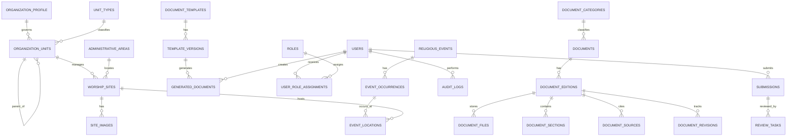

# AGENTS.md — Project Context & Working Agreement

> **Project:** Ban Chỉnh Đạo Digital Library
> **Document type:** Initial product / business / system blueprint and AI-agent working instructions
> **Version:** 0.1.0
> **Status:** Initial design — intentionally evolving, not a frozen specification
> **Last updated:** 2026-11-11
> **Primary language:** Vietnamese (technical identifiers may use English)

---

## 0. Cách Antigravity phải sử dụng tài liệu này

Tài liệu này là **bối cảnh nền ban đầu của dự án**, không phải yêu cầu phải triển khai tất cả chức năng ngay lập tức và cũng không phải đặc tả cuối cùng.

Khi làm việc trong repository này, hãy tuân thủ các nguyên tắc sau:

1.  Đọc tài liệu này trước khi lập kế hoạch hoặc thay đổi kiến trúc, database, API hay nghiệp vụ.
2.  Trước khi viết code, kiểm tra repository hiện tại: cấu trúc thư mục, công nghệ, skills agents đã cài, code đang có, migration, quy ước và các tài liệu khác. **Không giả định repository đang trống.**
3.  Phân biệt rõ:
   -  **Đã xác định:** phạm vi sản phẩm chỉ tập trung vào Hội Thánh Cao Đài Ban Chỉnh Đạo.
   -  **Đề xuất ban đầu:** stack, module, database, roadmap và các luồng nghiệp vụ trong tài liệu này; có thể điều chỉnh khi có căn cứ.
   -  **Chưa xác minh:** cơ cấu chính thức, danh sách cơ sở, kinh văn chuẩn, lịch lễ, nghi thức, quyền sử dụng tài liệu và các thông tin lịch sử cụ thể.
4.  Không tự biến giả định thành sự thật. Khi thiếu dữ liệu, dùng trạng thái `UNKNOWN`, `PENDING_VERIFICATION` hoặc ghi chú rõ giả định; không bịa tên cơ sở, kinh văn, ngày lễ, chức danh hay quan hệ tổ chức.
5.  Không triển khai toàn bộ hệ thống trong một lần. Chia thành các vertical slice nhỏ, hoàn thành và kiểm thử từng phần trước khi chuyển phần tiếp theo.
6.  Với yêu cầu mới, phân tích tác động đến nghiệp vụ, database, API, UI, quyền truy cập, bảo mật, kiểm thử và tài liệu. Cập nhật thiết kế liên quan trước hoặc cùng lúc với code.
7.  Không tự ý xóa, ghi đè hoặc làm mất dữ liệu/tính năng hiện có. Dùng migration an toàn, ưu tiên backward-compatible changes và có kế hoạch rollback khi thay đổi có rủi ro.
8.  Không tự tuyên bố website là trang chính thức của Hội Thánh. Chỉ sử dụng cách diễn đạt đó khi có căn cứ ủy quyền/xác nhận rõ ràng.
9.  Khi hoàn thành một task, báo cáo: thay đổi đã thực hiện, file quan trọng, cách chạy/test, kết quả test, vấn đề còn tồn tại và bước tiếp theo phù hợp.
10.  Nếu một yêu cầu mới mâu thuẫn với tài liệu này hoặc code hiện tại, hãy nêu rõ điểm xung đột và đề xuất phương án. Không âm thầm chọn một phương án có thể làm thay đổi ý nghĩa nghiệp vụ.
11.  **Duy trì tính liên tục đa thiết bị qua Git & State File (Luôn luôn áp dụng):** Không phụ thuộc vào database hội thoại cục bộ (`.db` local). Trước khi kết thúc phiên làm việc hoặc khi chuyển máy, luôn ghi nhận tiến độ, trạng thái hiện tại và các bước tiếp theo vào `HANDOFF.md` (hoặc tài liệu theo dõi liên quan), đảm bảo người dùng có thể `git push` từ máy này và mở phiên mới trên máy khác để tiếp tục ngay lập tức.

### Quy tắc làm việc theo yêu cầu

- Nếu người dùng yêu cầu **phân tích/thiết kế**, trước hết tạo hoặc cập nhật tài liệu; không tự ý code tính năng.
- Nếu người dùng yêu cầu **triển khai**, xác định một phạm vi hoàn thành được, lập kế hoạch ngắn, sau đó thực hiện trong repository.
- Nếu người dùng cung cấp yêu cầu mới, xem đó là phần mở rộng tự nhiên của sản phẩm. Không từ chối chỉ vì chưa có trong blueprint này.
- Khi thêm module/tính năng mới, cập nhật mục lục/roadmap và các tài liệu có liên quan. Không cần viết lại toàn bộ tài liệu nếu chỉ thay đổi một phần.
- Chỉ hỏi lại khi thiếu thông tin có thể làm thay đổi đáng kể tính đúng đắn, an toàn, quyền hạn hoặc dữ liệu. Với chi tiết nhỏ, chọn mặc định hợp lý và ghi rõ giả định.

### Quy tắc duy trì ngữ cảnh khi chuyển đổi máy (Cross-Device Continuity)

Áp dụng bắt buộc cơ chế **Git & State File** để đảm bảo khả năng tiếp tục công việc xuyên suốt giữa các máy tính:
1. **Trước khi kết thúc phiên / chuyển máy:**
   - Cập nhật [`HANDOFF.md`](HANDOFF.md): Tóm tắt những gì đã làm, trạng thái hiện tại của codebase/tài liệu, và các việc cần làm kế tiếp.
   - Nhắc người dùng hoặc tự động chuẩn bị commit để người dùng `git add .`, `git commit` và `git push`.
2. **Khi bắt đầu phiên mới trên máy khác:**
   - Đọc [`HANDOFF.md`](HANDOFF.md) và [`AGENTS.md`](AGENTS.md) trước tiên để nắm bắt ngữ cảnh dự án.
   - Bắt đầu thực thi ngay các bước tiếp theo với context sạch, không cần đồng bộ database chat cục bộ.

---

## 1. Tầm nhìn sản phẩm

Xây dựng một **nền tảng thư viện số, tra cứu và lưu trữ tri thức chuyên biệt về Hội Thánh Cao Đài Ban Chỉnh Đạo**, lấy việc bảo tồn tư liệu có nguồn gốc rõ ràng làm trọng tâm.

Tên làm việc: **Ban Chỉnh Đạo Digital Library**. Tên chính thức, logo, nhận diện và cách giới thiệu công khai sẽ được xác nhận sau.

### 1.1. Mục tiêu

- Sưu tầm, số hóa, phân loại, bảo quản và tra cứu kinh sách, Thánh ngôn, Thánh giáo, giáo lý, đạo sử và văn bản liên quan Ban Chỉnh Đạo.
- Cung cấp công cụ xem lịch Đạo, ngày lễ và các sự kiện đã được xác minh theo nguồn áp dụng của Ban Chỉnh Đạo.
- Xây dựng danh mục và bản đồ các cơ sở thuộc Ban Chỉnh Đạo, như Tòa Thánh, Họ đạo, Thánh Thất, Nhà tu và các cơ sở khác sau khi xác minh.
- Hỗ trợ soạn tài liệu bằng biểu mẫu được kiểm duyệt, lưu bản nháp và xuất Word/PDF.
- Tạo môi trường nghiên cứu, học tập và kết nối tư liệu, có trích dẫn nguồn.
- Cho phép hệ thống mở rộng dần theo yêu cầu thực tế mà không phải thiết kế lại toàn bộ nền tảng.

### 1.2. Nguyên tắc phạm vi

- **Phạm vi chính:** Hội Thánh Cao Đài Ban Chỉnh Đạo, gắn với Tòa Thánh Bến Tre/An Hội theo cách gọi trong tư liệu lịch sử. Tên địa giới, tên gọi hiện hành và địa chỉ phải được xác minh theo thời điểm.
- Không xây dựng sản phẩm như một thư viện đa Hội Thánh/đa chi phái.
- Tư liệu từ tổ chức Cao Đài khác chỉ được đưa vào khu vực **nghiên cứu/đối chiếu riêng**, nếu có lý do nghiên cứu rõ ràng; phải gắn nhãn nguồn và không hiển thị như kinh văn chính thức Ban Chỉnh Đạo.
- Không suy luận một tài liệu thuộc Ban Chỉnh Đạo chỉ vì tài liệu có nhắc đến Cao Đài, Bến Tre hoặc có tên bài kinh giống nhau.
- Nếu chưa có văn bản ủy quyền, nền tảng phải tự giới thiệu trung lập là dự án thư viện số/sưu tầm/bảo tồn/nghiên cứu tư liệu; không tự nhận là website chính thức, cơ quan phát ngôn hay đại diện Hội Thánh.

### 1.3. Ngoài phạm vi ở giai đoạn đầu

- Quản lý nhiều Hội Thánh/chi phái như các tenant ngang hàng.
- Mạng xã hội, diễn đàn mở hoặc nội dung do người dùng đăng tự do không qua kiểm duyệt.
- AI tự viết, sửa, diễn giải hoặc xác nhận kinh văn/nghi thức/lịch Đạo.
- Thanh toán, thương mại điện tử hoặc quyên góp trực tuyến, trừ khi có yêu cầu mới và được phân tích riêng.
- Ứng dụng di động native; ưu tiên website responsive/PWA trước.

---

## 2. Nhóm người dùng và vai trò

Vai trò dưới đây là **vai trò trên phần mềm**, không đại diện cho phẩm trật, chức sắc hay thẩm quyền tôn giáo.

| Vai trò           | Nhu cầu / quyền dự kiến                                                                                                                                |
| ------------------ | ---------------------------------------------------------------------------------------------------------------------------------------------------------- |
| `VISITOR`        | Xem nội dung công khai, tra cứu kinh sách, lịch và cơ sở thờ tự.                                                                                 |
| `MEMBER`         | Có thêm chức năng lưu dấu trang, quản lý tài liệu cá nhân, gửi đề xuất chỉnh sửa/đóng góp.                                            |
| `UNIT_ADMIN`     | Quản lý dữ liệu của đơn vị/cơ sở được giao; không có quyền tự duyệt nội dung giáo lý hoặc kinh văn.                                 |
| `LIBRARY_EDITOR` | Nhập metadata, số hóa, biên tập bản văn nháp và quản lý ấn bản theo phân công.                                                              |
| `REVIEWER`       | Thẩm định nội dung trong phạm vi chuyên môn/thẩm quyền được giao.                                                                              |
| `SYSTEM_ADMIN`   | Quản trị tài khoản, cấu hình, phân quyền và vận hành kỹ thuật. Không mặc nhiên có thẩm quyền xác nhận tính chính thống tôn giáo. |

### 2.1. Phân quyền có phạm vi

Sử dụng RBAC kết hợp phạm vi dữ liệu (scoped RBAC):

- Vai trò có thể được gán ở cấp toàn hệ thống hoặc một `organization_unit`/`worship_site` cụ thể.
- `UNIT_ADMIN` chỉ được sửa dữ liệu thuộc phạm vi được giao.
- Quyền biên tập không đồng nghĩa quyền phê duyệt.
- Quyền quản trị kỹ thuật không đồng nghĩa quyền xác nhận kinh văn, nghi lễ hoặc lịch lễ.
- Mọi hành động nhạy cảm phải được ghi `audit_logs`.

---

## 3. Phân hệ nghiệp vụ dự kiến

Các phân hệ là định hướng ban đầu. Có thể thêm, tách, gộp hoặc đổi thứ tự ưu tiên theo yêu cầu sau này.

### 3.1. Thư viện Đạo (phân hệ trọng tâm)

Danh mục nội dung dự kiến:

- Kinh Cúng Tứ Thời.
- Quan Hôn Tang Tế.
- Thánh Ngôn.
- Thánh Giáo.
- Giáo lý/giáo huấn.
- Đạo sử và tiểu sử nhân vật.
- Văn bản Hội Thánh: Hiến chương, Quy chế, Luật Công cử và văn bản khác nếu xác minh được.
- Tạp chí, ấn phẩm.
- Nghi lễ, Lễ Nhạc, tài liệu hướng dẫn.
- Khảo cứu và tài liệu tham khảo.
- Tư liệu đa phương tiện: ảnh, âm thanh, video.

Chức năng dự kiến:

- Danh mục phân cấp, bộ lọc và tìm kiếm toàn văn.
- Trang chi tiết tác phẩm, thông tin ấn bản, nguồn, tác giả/đơn vị phát hành.
- Trình đọc PDF/bản scan và bản văn điện tử.
- Mục lục có liên kết đến chương/bài/đoạn.
- Tìm kiếm theo tên bài, cụm từ và nội dung.
- Dấu trang, lưu vị trí đọc, tài liệu yêu thích (đối với tài khoản phù hợp).
- Tải xuống theo quyền sử dụng và chính sách của từng tài liệu.
- Hiển thị các ấn bản/phiên bản song song; không tự hợp nhất dị bản.
- Trích dẫn tài liệu với mã định danh, thông tin ấn bản và vị trí trang/đoạn nếu có.

**Nguyên tắc kinh văn:** Bản scan gốc là bằng chứng đối chiếu. OCR chỉ tạo bản nháp. Không tự sửa lỗi chính tả, dấu câu, từ cổ hoặc cách viết trong kinh văn nếu chưa có người đối chiếu/phê duyệt. Phải giữ nguyên bản gốc và lịch sử hiệu chỉnh.

### 3.2. Lịch Đạo

Chức năng dự kiến:

- Lịch tháng/tuần/ngày với âm lịch và dương lịch.
- Danh mục ngày lễ, ngày vía, ngày kỷ niệm và sự kiện được xác nhận.
- Lịch sinh hoạt/lễ tại từng cơ sở, nếu đơn vị cung cấp và cho phép công khai.
- Công cụ tra cứu/chuyển đổi âm lịch – dương lịch.
- Công cụ tính Tuần Cửu hoặc mốc nghi lễ khác chỉ sau khi quy tắc nghiệp vụ được xác minh.
- Đăng ký nhận nhắc lịch là tính năng mở rộng.

**Nguyên tắc lịch:**

- Không hard-code ngày dương cố định cho sự kiện âm lịch lặp hằng năm.
- Cần lưu ngày âm, tháng nhuận nếu áp dụng, quy tắc lặp, phạm vi áp dụng, múi giờ `Asia/Ho_Chi_Minh`, nguồn và người xác minh.
- Phân biệt `event_definition` (định nghĩa sự kiện) với `event_occurrence` (lần diễn ra của sự kiện trong một năm/ngày cụ thể).
- Không mặc định lịch của Hội Thánh/chi phái khác áp dụng cho Ban Chỉnh Đạo.
- Không tự suy diễn lịch hành lễ từ ngày lễ chung; lịch tại từng cơ sở cần nguồn riêng.

### 3.3. Soạn tài liệu (Document Composer)

Loại biểu mẫu dự kiến:

- Sớ văn và biểu mẫu nghi lễ được xác nhận.
- Biểu mẫu liên quan Quan Hôn Tang Tế, nếu được phép và có bản mẫu đáng tin cậy.
- Văn bản hành chính tại đơn vị: thông báo, biên bản, tờ trình và biểu mẫu khác.

Chức năng:

- Chọn mẫu theo loại tài liệu và phạm vi áp dụng.
- Mẫu có trường dữ liệu, quy tắc kiểm tra và phiên bản.
- Nhập dữ liệu, xem trước bố cục in, lưu nháp.
- Xuất DOCX/PDF, in A4.
- Lưu lịch sử tài liệu do người dùng tạo.

Không tự tạo mẫu nghi lễ mang tính chính thức. Mẫu phải có nguồn, đơn vị áp dụng, phiên bản, quyền sử dụng và trạng thái phê duyệt.

### 3.4. Hệ thống Thánh Sở / bản đồ

Chỉ đưa vào danh mục công khai những địa điểm đã được xác định thuộc phạm vi Ban Chỉnh Đạo.

Loại địa điểm có thể gồm:

- Tòa Thánh.
- Họ đạo.
- Thánh Thất.
- Nhà tu.
- Ban/đơn vị có địa điểm hoạt động.
- Cơ sở thờ tự khác sau khi được xác minh.

Thông tin địa điểm dự kiến:

- Tên chính thức và tên gọi khác.
- Loại địa điểm.
- Đơn vị quản lý/đơn vị trực thuộc.
- Địa chỉ hiện hành và địa chỉ lịch sử.
- Tọa độ latitude/longitude.
- Ảnh, mô tả, thông tin liên hệ công khai.
- Lịch hoạt động/lễ nếu được xác nhận.
- Trạng thái hoạt động và trạng thái xác minh.
- Nguồn xác minh, người xác minh, ngày xác minh gần nhất.

Chức năng:

- Danh sách và bản đồ tương tác.
- Lọc theo địa bàn, loại địa điểm, đơn vị quản lý và trạng thái.
- Tìm kiếm theo tên.
- Trang hồ sơ riêng từng địa điểm.
- Đề xuất sửa thông tin/báo cáo sai lệch.
- Quản trị viên đơn vị gửi cập nhật; người có thẩm quyền duyệt trước khi công khai.

**Địa giới:** Phải lưu lịch sử địa giới và địa chỉ theo thời kỳ. Không ghi đè địa chỉ lịch sử khi có sắp xếp hành chính. Dữ liệu địa giới cần dựa trên nguồn chính thức tại thời điểm cập nhật.

### 3.5. Nghiên cứu và Học Đạo

Có thể bao gồm:

- Lịch sử hình thành và phát triển Ban Chỉnh Đạo.
- Tiểu sử các vị tiền bối/chức sắc dựa trên nguồn đã dẫn.
- Từ điển thuật ngữ, từ cổ, điển cố.
- Bài khảo cứu và chủ đề học tập.
- Liên kết tài liệu theo nhân vật, thời kỳ, địa danh, sự kiện, tác phẩm và nghi lễ.
- Hỏi đáp dựa trên nguồn thư viện (AI/RAG) ở giai đoạn sau.

Không trình bày nội dung nghiên cứu thứ cấp như văn bản ban hành chính thức. Luôn hiển thị tác giả, nguồn và phân loại tài liệu.

### 3.6. Quản trị nội dung (Admin Portal)

- Quản lý tài liệu, danh mục, ấn bản, file và nguồn.
- Quản lý quy trình biên tập/kiểm duyệt/xuất bản.
- Quản lý lịch lễ và nguồn xác minh.
- Quản lý đơn vị và địa điểm.
- Quản lý biểu mẫu và phiên bản.
- Quản lý người dùng, vai trò, phạm vi quyền.
- Quản lý đề xuất đóng góp.
- Audit log, báo cáo chất lượng dữ liệu và sao lưu.

---

## 4. Quy trình nghiệp vụ chính

### 4.1. Tiếp nhận và xuất bản tài liệu

1. Người có quyền tạo hồ sơ tài liệu hoặc gửi đóng góp.
2. Nhập metadata: tên, loại, tác giả/đơn vị ban hành, năm, nguồn, phạm vi, quyền sử dụng.
3. Tải bản scan/file gốc vào kho lưu trữ.
4. Nếu cần, chạy OCR để tạo bản văn nháp.
5. Biên tập đối chiếu bản văn với bản gốc.
6. Gửi reviewer thẩm định.
7. Reviewer yêu cầu chỉnh sửa hoặc phê duyệt theo thẩm quyền.
8. Xuất bản với trạng thái và thông tin nguồn rõ ràng.
9. Lưu revision, người thực hiện, thời gian và checksum của file gốc.

Trạng thái đề xuất: `DRAFT`, `SUBMITTED`, `IN_REVIEW`, `REVISION_REQUIRED`, `APPROVED`, `PUBLISHED`, `ARCHIVED`, `REJECTED`.

### 4.2. Cập nhật địa điểm

1. Người dùng/đơn vị gửi đề xuất cập nhật.
2. Hệ thống tạo submission, không sửa trực tiếp dữ liệu đã công khai.
3. Người phụ trách kiểm tra nguồn, địa chỉ, tọa độ và đơn vị liên quan.
4. Phê duyệt hoặc yêu cầu bổ sung/từ chối.
5. Cập nhật dữ liệu và lưu lịch sử trước/sau.

### 4.3. Quản lý lịch

1. Tạo định nghĩa sự kiện và quy tắc ngày.
2. Gắn tài liệu nguồn, phạm vi áp dụng và đơn vị chịu trách nhiệm.
3. Tính/nhập lần diễn ra cụ thể.
4. Đối chiếu và phê duyệt.
5. Công khai lịch chung hoặc lịch của cơ sở.
6. Ghi nhận mọi điều chỉnh sau công bố.

### 4.4. Soạn tài liệu

1. Chọn mẫu đã được duyệt.
2. Hệ thống hiển thị phạm vi áp dụng và phiên bản mẫu.
3. Người dùng nhập dữ liệu.
4. Xem trước, kiểm tra trường bắt buộc.
5. Lưu nháp hoặc xuất file.
6. Lưu metadata bản đã tạo; bảo vệ dữ liệu cá nhân theo chính sách lưu trữ.

---

## 5. Mô hình dữ liệu định hướng

Đề xuất ban đầu: **PostgreSQL + PostGIS**, mô hình quan hệ. Đây là định hướng, cần xác nhận khi khảo sát yêu cầu và hạ tầng thực tế.

### 5.1. Nhóm bảng dự kiến

**Tổ chức và địa điểm**

- `organization_profile`: thông tin Hội Thánh ở cấp gốc (một hồ sơ tổ chức trong phạm vi hiện tại).
- `unit_types`: loại đơn vị.
- `organization_units`: cây đơn vị trực thuộc, quan hệ cha-con.
- `worship_sites`: địa điểm thờ tự/vật lý.
- `site_images`, `site_contacts`: ảnh và liên hệ.
- `administrative_areas`: địa giới hành chính và lịch sử hiệu lực.
- `site_verification_records`: lịch sử xác minh địa điểm.

**Thư viện**

- `document_categories`: danh mục.
- `documents`: tác phẩm/đầu mục thư viện.
- `document_editions`: ấn bản/phiên bản cụ thể.
- `document_files`: PDF, ảnh scan, audio và file khác.
- `document_sections`: chương, mục, bài kinh.
- `document_contents`: nội dung văn bản đã biên tập.
- `document_sources`: nguồn xuất xứ và tham chiếu lưu trữ.
- `document_revisions`: lịch sử sửa đổi nội dung/metadata.

**Lịch Đạo**

- `religious_events`: định nghĩa sự kiện.
- `calendar_rules`: quy tắc ngày âm/dương/lặp.
- `event_occurrences`: lần diễn ra cụ thể.
- `event_locations`: địa điểm tổ chức.
- `calendar_sources`: nguồn và chứng cứ xác minh.

**Soạn tài liệu**

- `document_templates`: mẫu.
- `template_versions`: phiên bản mẫu.
- `generated_documents`: tài liệu do người dùng tạo.
- `generated_files`: file xuất ra.

**Người dùng và kiểm duyệt**

- `users`, `roles`, `permissions`.
- `user_role_assignments`: gán vai trò và phạm vi.
- `submissions`, `review_tasks`.
- `bookmarks`, `notifications` (nếu cần).
- `audit_logs`.

### 5.2. Nguyên tắc mô hình hóa

- `documents` khác `document_editions`: một tác phẩm có thể có nhiều ấn bản.
- `document_editions` khác `document_files`: một ấn bản có thể có nhiều file (scan, PDF tối ưu, bản văn, audio liên quan).
- Tệp gốc cần bất biến về mặt lưu trữ; khi thay file, tạo phiên bản/file mới và ghi nhận lịch sử.
- `organization_units` khác `worship_sites`: đơn vị tổ chức không nhất thiết là một địa điểm vật lý; một đơn vị có thể quản lý nhiều địa điểm.
- Dùng quan hệ cha-con cho cây đơn vị; không hard-code số cấp.
- Sự kiện định nghĩa khác lần diễn ra; tránh lưu ngày dương cố định cho ngày lễ âm lịch.
- Địa chỉ hiện hành khác địa chỉ lịch sử; có hiệu lực từ/đến.
- Không lưu bản sao nội dung từ nguồn khác như bản chính thức nếu chưa xác minh.
- Mọi bảng quan trọng nên có primary key, foreign key, timestamps, trạng thái và audit phù hợp.
- Chỉ thêm bảng/field khi có use case rõ; tránh thiết kế quá mức ngay từ đầu.

### 5.3. Trường nguồn và xác minh

Metadata tài liệu tối thiểu nên cân nhắc:

- `source_name`, `publisher`, `author_or_issuing_body`.
- `publication_year`, `edition_label`, `archive_reference`.
- `source_url` (nếu có), `copyright_status`, `usage_permission`.
- `verification_status`, `verified_by`, `verified_at`, `verification_note`.
- `organization_scope` hoặc liên kết phù hợp để biểu thị tài liệu có liên quan Ban Chỉnh Đạo như thế nào.

Trạng thái gợi ý:

- `UNVERIFIED`: chưa xác minh.
- `VERIFIED`: đã đối chiếu với nguồn đáng tin cậy.
- `OFFICIALLY_CONFIRMED`: có bằng chứng xác nhận từ đơn vị/người có thẩm quyền phù hợp.

Không cấp `OFFICIALLY_CONFIRMED` chỉ dựa trên đánh giá của AI hoặc System Admin. Cần lưu bằng chứng xác nhận.

### 5.4. ERD khái niệm ban đầu



ERD này chỉ là mô hình khái niệm. Trước khi migration phải rà soát cardinality, optionality, unique constraints, indexes, deletion strategy và yêu cầu audit.

---

## 6. Kiến trúc kỹ thuật đề xuất

### 6.1. Định hướng

- **Modular Monolith** ở giai đoạn đầu; không mặc định dùng microservices.
- Một backend có module nghiệp vụ tách biệt, một database quan hệ chính.
- Tách xử lý nền (OCR, tạo DOCX/PDF, import dữ liệu) thành worker khi thực sự cần.
- Giữ ranh giới module rõ để có thể tách dịch vụ sau này nếu có lý do về tải, vận hành hoặc đội ngũ.

### 6.2. Stack tham khảo (chưa phải quyết định bất biến)

| Layer          | Đề xuất                                 | Ghi chú                                                                       |
| -------------- | ------------------------------------------ | ------------------------------------------------------------------------------ |
| Frontend       | Next.js + TypeScript                       | Responsive, SEO, portal công khai và admin                                   |
| UI             | Tailwind CSS + component library phù hợp | Ưu tiên dễ đọc, khả năng tiếp cận                                     |
| Backend        | NestJS + TypeScript                        | REST API, module nghiệp vụ, validation, Swagger/OpenAPI                      |
| ORM            | Prisma                                     | Đề xuất ban đầu; có thể đổi nếu repository/hạ tầng yêu cầu khác |
| Database       | PostgreSQL                                 | Dữ liệu quan hệ và full-text search                                        |
| GIS            | PostGIS                                    | Truy vấn địa lý, khoảng cách và bản đồ                               |
| Cache/Queue    | Redis + BullMQ                             | Chỉ triển khai khi cần cache/job queue                                      |
| File storage   | S3-compatible / MinIO                      | Lưu bản scan, PDF, audio và file xuất                                      |
| Map UI         | MapLibre hoặc thư viện tương đương | Chọn nhà cung cấp tile/geocoding sau khi đánh giá giấy phép/chi phí   |
| Search         | PostgreSQL Full-text Search ban đầu      | Có thể bổ sung engine khác khi dữ liệu/tải cần thiết                  |
| AI tương lai | LLM API + RAG + pgvector                   | Không phải điều kiện để hoàn thành MVP                                |
| Deployment     | Docker Compose ban đầu                   | Bổ sung CI/CD, backup, monitoring theo môi trường                          |

Không cài hoặc thêm công nghệ chỉ vì được liệt kê ở đây. Trước khi thêm dependency, xác định use case, chi phí vận hành, giấy phép, khả năng bảo trì và phương án thay thế.

### 6.3. Module backend dự kiến

- `auth`: authentication/session/token.
- `users`: hồ sơ và tài khoản.
- `access-control`: roles, permissions, scoped assignments.
- `organization`: hồ sơ Hội Thánh và cây đơn vị.
- `library`: tác phẩm, ấn bản, file, mục lục, nội dung, nguồn.
- `calendar`: sự kiện, quy tắc, lần diễn ra, địa điểm.
- `worship-sites`: cơ sở, địa giới, tọa độ, xác minh.
- `document-composer`: mẫu và tài liệu tạo ra.
- `search`: tìm kiếm và indexing.
- `workflow`: submission, review, publish.
- `audit`: lịch sử thao tác.
- `notifications`: thông báo nếu được đưa vào phạm vi.

### 6.4. Cấu trúc repository tham khảo

Chỉ áp dụng sau khi kiểm tra repository; không ép cấu trúc này lên code hiện có.

```text
project-root/
├── AGENTS.md
├── README.md
├── docs/
│   ├── requirements/
│   ├── architecture/
│   ├── data-model/
│   ├── api/
│   └── decisions/
├── apps/
│   ├── web/                 # Next.js
│   └── api/                 # NestJS
├── packages/                # shared types/config nếu thực sự cần
├── infra/                   # Docker, deployment, scripts
└── .env.example
```

---

## 7. Yêu cầu phi chức năng

### 7.1. Tính toàn vẹn và độ tin cậy

- Không làm mất bản scan gốc hoặc metadata nguồn.
- Có lịch sử chỉnh sửa và người chịu trách nhiệm.
- Công khai rõ tài liệu nào đã xác minh, chưa xác minh hoặc chỉ là tài liệu tham khảo.
- Không hiển thị nội dung nháp như nội dung đã xuất bản.

### 7.2. Bảo mật và quyền riêng tư

- Mật khẩu phải được hash bằng thuật toán phù hợp; không lưu plaintext.
- Validate input ở backend; kiểm soát quyền ở server, không chỉ ẩn nút trên frontend.
- Kiểm soát upload: loại file, dung lượng, tên file, quyền truy cập và quét file nếu hạ tầng hỗ trợ.
- Bảo vệ tài liệu nội bộ/draft khỏi truy cập công khai.
- Hạn chế thu thập dữ liệu cá nhân; không công khai số điện thoại/thông tin cá nhân nếu chưa có căn cứ cho phép.
- Secrets chỉ lưu trong environment/secret manager, không commit vào Git.
- Có backup database và file storage; định kỳ kiểm tra khả năng khôi phục.

### 7.3. Khả năng sử dụng

- Mobile-first/responsive.
- Nội dung kinh sách cần font dễ đọc, hỗ trợ Unicode tiếng Việt và cách viết cổ.
- Reader hỗ trợ tăng/giảm cỡ chữ, mục lục, chuyển trang và liên kết trích dẫn khi có dữ liệu.
- Có trạng thái loading, empty, error và nội dung không tìm thấy.
- Các chức năng quan trọng phải có thông báo kết quả rõ ràng.

### 7.4. Hiệu năng và vận hành

- Phân trang cho danh sách lớn.
- Index cho trường tìm kiếm/lọc và khóa ngoại thường dùng.
- File lớn sử dụng object storage, không lưu binary lớn trực tiếp trong bảng quan hệ trừ khi có lý do rõ.
- Tác vụ OCR/export/import chạy nền khi cần, có retry và trạng thái xử lý.
- Có logging, health check và theo dõi lỗi cơ bản.

### 7.5. SEO và khả năng tiếp cận

- Trang tài liệu công khai có URL ổn định, title/description phù hợp và metadata.
- Dùng semantic HTML, keyboard navigation và contrast dễ đọc.
- Không phụ thuộc hoàn toàn vào màu sắc để biểu thị trạng thái.

---

## 8. Nguyên tắc AI và OCR

AI là công cụ hỗ trợ tra cứu, không phải nguồn thẩm quyền.

### 8.1. OCR

- OCR chỉ tạo nội dung nháp.
- Lưu liên kết đến trang/ảnh gốc để đối chiếu.
- Có thể lưu confidence theo trang/đoạn nếu công cụ cung cấp.
- Không tự động xuất bản OCR.

### 8.2. AI/RAG trong tương lai

Khi triển khai hỏi đáp:

1. Chỉ truy xuất các tài liệu phù hợp với bộ lọc nguồn/phạm vi.
2. Ưu tiên nội dung đã được xác minh và công khai.
3. Trả lời kèm trích dẫn đến tài liệu, ấn bản, trang/đoạn.
4. Nếu không tìm thấy căn cứ, nói rõ không đủ nguồn; không tự hoàn thiện bằng suy đoán.
5. Tách rõ câu trả lời dựa trên tài liệu Ban Chỉnh Đạo với tài liệu nghiên cứu thứ cấp.
6. Không để prompt injection nằm trong tài liệu tải lên điều khiển hành vi hệ thống.
7. Không cho AI chỉnh sửa kinh văn, lịch lễ hoặc mẫu nghi thức chính thức.

---

## 9. Roadmap định hướng

Roadmap có thể thay đổi theo dữ liệu, nguồn lực và yêu cầu mới.

### P0 — Nền tảng và thư viện tối thiểu

- Khởi tạo project structure, CI/lint/test cơ bản.
- Database và migration nền tảng.
- Authentication và scoped RBAC cơ bản.
- Hồ sơ tổ chức và cây đơn vị ở mức cần thiết.
- Admin quản lý danh mục/tài liệu/ấn bản/file/source.
- Quy trình draft → review → publish.
- Trang thư viện công khai, trang chi tiết tài liệu và reader cơ bản.
- Tìm kiếm theo metadata và nội dung đã nhập.
- Kiểm thử quyền truy cập, nguồn và phiên bản.

**Bộ dữ liệu pilot gợi ý:** Kinh Cúng Tứ Thời và Quan Hôn Tang Tế Ban Chỉnh Đạo, nhưng chỉ nhập/xuất bản khi có bản tài liệu và nguồn được xác minh. Đây là lựa chọn pilot, không khẳng định đã có đầy đủ bản số hóa hợp lệ.

### P1 — Lịch Đạo và Thánh Sở

- Danh mục sự kiện và lần diễn ra.
- Xử lý âm lịch theo quy tắc đã xác nhận.
- Danh mục cơ sở, địa chỉ lịch sử/hiện hành, tọa độ và bản đồ.
- Quy trình đơn vị gửi cập nhật và reviewer xác minh.
- Lịch sự kiện tại cơ sở nếu có nguồn.

### P1/P2 — Soạn tài liệu

- Quản lý mẫu và phiên bản.
- Biểu mẫu nhập dữ liệu và xem trước.
- Xuất DOCX/PDF.
- Lưu tài liệu cá nhân và quyền riêng tư.

### P2 — Nghiên cứu và tính năng nâng cao

- Từ điển, hồ sơ nhân vật, timeline lịch sử.
- Liên kết tri thức giữa tài liệu/nhân vật/sự kiện/địa điểm.
- OCR nâng cao và so sánh bản văn.
- AI/RAG có dẫn nguồn.
- PWA, offline reading hoặc ứng dụng khác nếu có nhu cầu.

---

## 10. Tiêu chí nghiệm thu ban đầu

Một tính năng chỉ được xem là hoàn thành khi có cả nghiệp vụ, UI/API, quyền truy cập và kiểm thử phù hợp.

### Thư viện

- Có thể tạo tác phẩm, ấn bản và liên kết file/nguồn.
- Có thể xem tài liệu công khai và mục lục.
- Tìm kiếm trả về kết quả đúng với dữ liệu đã nhập.
- Không hiển thị bản nháp/nhạy cảm ra công khai.
- Có thể truy ngược nguồn và phiên bản.

### Lịch

- Mỗi sự kiện có quy tắc/phạm vi/nguồn.
- Có thể phân biệt ngày âm và dương.
- Các lần diễn ra theo năm được lưu rõ ràng.
- Không công bố ngày chưa xác minh như ngày chính thức.

### Thánh Sở

- Hồ sơ có loại địa điểm, đơn vị quản lý và trạng thái xác minh.
- Có tọa độ/địa chỉ được kiểm tra trước khi công khai vị trí.
- Có thể lưu lịch sử thay đổi địa chỉ.

### Soạn tài liệu

- Chỉ dùng mẫu đã được duyệt.
- Có thể lưu nháp và xem trước.
- File xuất ra có bố cục kiểm tra được.
- Có kiểm soát quyền truy cập tài liệu đã tạo.

### Admin và bảo mật

- Server-side authorization được kiểm thử.
- Có audit log cho thao tác quan trọng.
- Có migration và backup strategy.
- Có test cho luồng thành công, lỗi, quyền bị từ chối và dữ liệu biên.

---

## 11. Quản lý yêu cầu mới và tiến hóa sản phẩm

**Đây là nguyên tắc quan trọng:** blueprint này chỉ mô tả phiên bản thiết kế ban đầu. Sản phẩm được phép phát triển theo nhu cầu mới trong suốt quá trình làm việc.

Khi người dùng đưa ra yêu cầu mới, thực hiện quy trình:

1. **Capture:** ghi lại yêu cầu bằng ngôn ngữ nghiệp vụ, vấn đề cần giải quyết và người dùng hưởng lợi.
2. **Classify:** xác định đây là chức năng mới, thay đổi chức năng cũ, lỗi, yêu cầu dữ liệu hay yêu cầu phi chức năng.
3. **Analyze:** xác định actor, preconditions, main flow, alternative/error flows, business rules và acceptance criteria.
4. **Impact analysis:** đánh giá ảnh hưởng tới module, database/ERD, API, UI, permission, security/privacy, migration, test, deployment và dữ liệu cũ.
5. **Decision:** đề xuất cách xử lý; ghi các giả định và trade-off. Không tự thêm tính năng ngoài yêu cầu chỉ vì thấy “hay”.
6. **Update docs:** cập nhật tài liệu yêu cầu, ERD/API/architecture/roadmap nếu bị ảnh hưởng.
7. **Implement incrementally:** phát triển theo lát cắt nhỏ, có test.
8. **Verify:** chạy lint, type-check, unit/integration/e2e tests phù hợp; báo cáo rõ phần chưa kiểm chứng.

### 11.1. Tài liệu nên được tạo dần khi dự án lớn lên

Không cần tạo hết ngay ngày đầu. Khi có nội dung tương ứng, duy trì:

```text
docs/
├── requirements/
│   ├── BRD.md
│   ├── SRS.md
│   ├── USER_STORIES.md
│   └── CHANGELOG.md
├── architecture/
│   ├── SYSTEM_OVERVIEW.md
│   └── MODULES.md
├── data-model/
│   └── ERD.md
├── api/
│   └── API_CONVENTIONS.md
└── decisions/
    ├── ADR-001-modular-monolith.md
    └── ADR-002-postgresql.md
```

- `AGENTS.md` giữ nguyên tắc và bối cảnh cấp cao.
- `BRD.md`/`SRS.md` lưu yêu cầu nghiệp vụ/chi tiết có thể thay đổi.
- `CHANGELOG.md` ghi thay đổi yêu cầu có ý nghĩa.
- ADR (Architecture Decision Record) ghi quyết định kiến trúc, lý do, phương án thay thế và hệ quả.
- Khi tài liệu khác mâu thuẫn, ưu tiên quyết định mới nhất đã được người dùng xác nhận; cập nhật các tài liệu liên quan để không tồn tại hai sự thật.

### 11.2. Mẫu ghi nhận yêu cầu mới

```text
ID:
Tên yêu cầu:
Trạng thái: PROPOSED | APPROVED | IN_PROGRESS | DONE | DEFERRED
Người dùng/Actor:
Vấn đề cần giải quyết:
Mô tả nghiệp vụ:
Luồng chính:
Luồng ngoại lệ:
Quy tắc nghiệp vụ:
Dữ liệu bị ảnh hưởng:
API/UI/module bị ảnh hưởng:
Phân quyền và bảo mật:
Acceptance criteria:
Dependencies:
Migration/backward compatibility:
Quyết định và giả định:
```

---

## 12. Các thông tin còn phải xác minh — không được tự suy đoán

Các mục dưới đây là backlog nghiên cứu nghiệp vụ, không phải dữ liệu đã xác nhận:

1. Tên gọi chính thức, cách viết tên Hội Thánh/Tòa Thánh và thông tin nhận diện được phép sử dụng.
2. Cơ cấu tổ chức hiện hành và quan hệ chính thức giữa các cấp/đơn vị.
3. Danh sách Họ đạo, Nhà tu, Thánh Thất và các cơ sở; trạng thái hoạt động; địa chỉ và tọa độ.
4. Bản kinh chuẩn, các ấn bản, dị bản, năm in và nơi lưu trữ; đặc biệt Kinh Cúng Tứ Thời và Quan Hôn Tang Tế.
5. Nguồn lịch Đạo có thẩm quyền, quy tắc tính ngày âm, ngày lễ và Tuần Cửu.
6. Mẫu sớ văn, biểu mẫu nghi lễ và phạm vi được phép số hóa/công bố.
7. Bản quyền, quyền số hóa, quyền hiển thị và quyền tải từng tài liệu.
8. Người/đơn vị có thẩm quyền thẩm định từng nhóm nội dung.
9. Mức độ chính thức/độc lập của dự án và việc có được Hội Thánh hoặc đơn vị trực thuộc hỗ trợ hay không.
10. Yêu cầu lưu trữ, bảo mật và dữ liệu cá nhân của người dùng.

Không dùng số liệu thống kê từ một bài báo hoặc nguồn thứ cấp làm số liệu hiện hành trong hệ thống nếu chưa đối chiếu với nguồn có thẩm quyền và ngày hiệu lực.

---

## 13. Hướng dẫn task đầu tiên cho Antigravity

Khi bắt đầu làm việc với repository, hãy thực hiện theo thứ tự:

1. Đọc `AGENTS.md` này.
2. Kiểm tra repository và báo cáo hiện trạng: framework, package manager, cấu trúc, code có sẵn, database/migration, test và cấu hình triển khai.
3. Liệt kê các quyết định đã có trong code và các điểm chưa rõ; không ghi đè cấu hình hiện có.
4. Đề xuất kế hoạch triển khai MVP theo từng bước nhỏ, kèm file/module sẽ tạo hoặc chỉnh sửa.
5. Ưu tiên hoàn thiện **nền tảng + thư viện số pilot** trước. Chưa triển khai đồng loạt tất cả phân hệ.
6. Trước khi tạo schema/migration, trình bày ERD và giải thích các quan hệ quan trọng; sau đó mới triển khai theo task được yêu cầu.
7. Sau mỗi vertical slice, chạy test phù hợp và cung cấp cách kiểm thử thủ công/API.

Không tự nhập nội dung kinh sách hoặc dữ liệu Thánh Sở giả lập vào môi trường production. Dữ liệu demo phải được đánh dấu rõ là `DEMO`/`SEED` và không được trình bày như dữ liệu thật.

---

## 14. Tài liệu tham khảo và ghi chú nguồn

Các nguồn sau được dùng để định hướng khảo sát ban đầu, không mặc nhiên là nguồn chính thức cho mọi dữ liệu:

- Antigravity — Rules: https://antigravity.google/docs/rules/ . Tài liệu hướng dẫn cách Antigravity nạp `AGENTS.md`, `GEMINI.md` và workspace rules.
- Antigravity — Learn command: https://antigravity.google/docs/commands/learn . Tham khảo cách lưu kiến thức/rules ở workspace.
- CaoDaiON — trang giới thiệu ứng dụng: https://www.caodaion.com/apps . Dùng để tham khảo ý tưởng chức năng (lịch, Tuần Cửu, tra cứu kinh, soạn sớ văn, văn bản); không mặc định nội dung/kinh văn của nền tảng này là tài liệu Ban Chỉnh Đạo nếu chưa xác minh.
- Cao Đài E-book: https://caodaiebook.net/ . Dùng làm đầu mối khảo sát kho tài liệu; cần kiểm tra riêng nguồn gốc, ấn bản, phạm vi Hội Thánh và quyền sử dụng từng tài liệu.
- Kinh Sách Cao-Đài: https://tusachcaodai.wordpress.com/ . Nguồn tham khảo/sưu tầm; không mặc định là kho chính thức của Ban Chỉnh Đạo.
- Các bài viết của cơ quan nhà nước/đơn vị địa phương về Hội Thánh Ban Chỉnh Đạo: dùng làm nguồn tham khảo và đầu mối xác minh; ghi rõ ngày đăng và đối chiếu trước khi đưa dữ liệu vào hệ thống.

Khi bổ sung nguồn mới, lưu URL trực tiếp, ngày truy cập, loại nguồn, nội dung được hỗ trợ và trạng thái xác minh. Tránh dựa riêng vào snippet của công cụ tìm kiếm.

---

## 15. Tóm tắt định hướng để giữ nhất quán

- Sản phẩm tập trung **duy nhất vào Hội Thánh Cao Đài Ban Chỉnh Đạo**.
- Trọng tâm là **thư viện số có nguồn gốc, ấn bản và lịch sử xác minh**.
- Hai phân hệ kết nối cộng đồng là **Lịch Đạo** và **Bản đồ Thánh Sở**.
- **Soạn tài liệu** chỉ sử dụng biểu mẫu có nguồn và được duyệt.
- Công nghệ ban đầu đề xuất: **Next.js + TypeScript, NestJS, PostgreSQL + PostGIS, Prisma, S3/MinIO**, triển khai theo **Modular Monolith**; được phép điều chỉnh sau khi phân tích.
- **Không bịa dữ liệu, không tự xác nhận tính chính thống, không để AI sửa kinh văn.**
- Đây là **thiết kế ban đầu có thể mở rộng**. Mọi yêu cầu mới phải được phân tích tác động, cập nhật tài liệu và triển khai từng bước; không coi danh sách hiện tại là giới hạn cuối cùng của sản phẩm.
