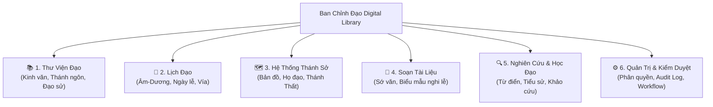

# Ban Chỉnh Đạo Digital Library
### Nền Tảng Thư Viện Số & Lưu Trữ Tri Thức Cao Đài Ban Chỉnh Đạo

> **Lưu ý về pháp lý & định danh:** Dự án hiện đang trong giai đoạn nghiên cứu, thiết kế và số hóa độc lập nhằm mục đích bảo tồn văn hóa, lịch sử và giáo lý. Dự án **không** tự nhận là trang thông tin điện tử chính thức, cơ quan phát ngôn hay đại diện của Hội Thánh Cao Đài Ban Chỉnh Đạo trừ khi có văn bản ủy quyền chính thức.

---

## 📖 1. Giới Thiệu Dự Án

**Ban Chỉnh Đạo Digital Library** là nền tảng số hóa, lưu trữ, tra cứu và nghiên cứu tư liệu chuyên biệt về **Hội Thánh Cao Đài Ban Chỉnh Đạo** (gắn liền với Tòa Thánh Bến Tre / An Hội theo tư liệu lịch sử).

Dự án ra đời nhằm mục tiêu ứng dụng công nghệ hiện đại vào việc bảo tồn các di sản văn hóa, kinh văn, đạo sử quý báu có nguồn gốc rõ ràng, cung cấp công cụ học tập và tra cứu đáng tin cậy cho tín đồ, nhà nghiên cứu và công chúng quan tâm.

### 🎯 Tầm nhìn & Mục tiêu cốt lõi:
1. **Bảo tồn di sản:** Sưu tầm, số hóa, phân loại và lưu trữ lâu dài kinh sách, Thánh ngôn, Thánh giáo, đạo sử, tạp chí và văn bản lịch sử của Ban Chỉnh Đạo.
2. **Tra cứu chuẩn xác:** Cung cấp công cụ tra cứu lịch Đạo (âm – dương), ngày lễ vía, kỷ niệm theo đúng quy tắc và nguồn áp dụng của Ban Chỉnh Đạo.
3. **Bản đồ Thánh sở:** Xây dựng danh mục và bản đồ số định vị các cơ sở thờ tự (Tòa Thánh, Họ đạo, Thánh Thất, Nhà tu...) đã được xác minh thông tin địa giới và lịch sử.
4. **Hỗ trợ hành chánh & nghi lễ:** Cung cấp công cụ soạn thảo biểu mẫu, sớ văn (Document Composer) chuẩn xác theo từng phạm vi áp dụng và phiên bản đã kiểm duyệt.
5. **Nghiên cứu & Học tập:** Môi trường học Đạo trực tuyến có trích dẫn nguồn gốc xuất xứ, giữ gìn tính nguyên bản của văn tự cổ.

---

## 🏛️ 2. Các Phân Hệ Nghiệp Vụ Chính

Hệ thống được thiết kế theo hướng module hóa linh hoạt gồm 6 phân hệ:

1. **Thư viện Đạo (Phân hệ trọng tâm):**
   * Quản lý Kinh Cúng Tứ Thời, Quan Hôn Tang Tế, Thánh Ngôn, Thánh Giáo, Hiến chương, Tạp chí, Hình ảnh/Âm thanh lịch sử.
   * Đọc trực tuyến song song bản scan gốc đối chiếu và bản văn điện tử; tìm kiếm toàn văn; trích dẫn nguồn.
2. **Lịch Đạo:**
   * Lịch âm – dương chuẩn múi giờ `Asia/Ho_Chi_Minh`, hiển thị ngày lễ, ngày vía của Ban Chỉnh Đạo (tách biệt định nghĩa sự kiện `event_definition` và lần diễn ra `event_occurrence`).
3. **Hệ thống Thánh Sở & Bản đồ:**
   * Danh mục và bản đồ định vị Tòa Thánh Bến Tre và các cơ sở trực thuộc. Lưu trữ lịch sử thay đổi địa giới hành chính qua các thời kỳ.
4. **Soạn tài liệu (Document Composer):**
   * Soạn thảo và in ấn sớ văn, biểu mẫu nghi lễ hoặc văn bản hành chánh nội bộ theo mẫu chuẩn được duyệt; hỗ trợ xuất PDF/DOCX khổ A4.
5. **Nghiên cứu và Học Đạo:**
   * Từ điển thuật ngữ, điển cố, tiểu sử tiền bối chức sắc, các bài khảo cứu có đối chiếu nguồn.
6. **Quản trị nội dung & Kiểm duyệt (Admin Portal):**
   * Quản lý vòng đời tài liệu: Nháp (`DRAFT`) ➔ Thẩm định (`IN_REVIEW`) ➔ Phê duyệt (`APPROVED`) ➔ Xuất bản (`PUBLISHED`).

---

## ⚖️ 3. Nguyên Tắc Bảo Tồn & Quy Chuẩn Dữ Liệu

* **Tôn trọng bản gốc:** Bản scan tài liệu gốc luôn là bằng chứng đối chiếu tối cao. OCR chỉ tạo bản nháp; **không tự ý sửa chữa** từ ngữ cổ, chính tả, dấu câu hay dị bản lịch sử khi chưa có hội đồng thẩm định chuyên môn phê duyệt.
* **Minh bạch nguồn gốc:** Mọi tài liệu, ngày lễ, địa điểm đều phải gắn liền với nguồn xuất xứ (`source`), người xác minh và mức độ tin cậy (`UNVERIFIED`, `VERIFIED`, `OFFICIALLY_CONFIRMED`).
* **Không suy diễn:** Tuyệt đối không tự suy diễn tài liệu của các chi phái Cao Đài khác sang Ban Chỉnh Đạo, hoặc suy diễn một tài liệu thuộc Ban Chỉnh Đạo chỉ vì có tên bài tương tự.
* **Phân quyền có phạm vi (Scoped RBAC):** Quyền quản trị kỹ thuật (`SYSTEM_ADMIN`) tách biệt với thẩm quyền xác nhận tôn giáo (`REVIEWER`); quyền của đơn vị cơ sở (`UNIT_ADMIN`) chỉ giới hạn trong phạm vi cơ sở đó.

---

## 🛠️ 4. Định Hướng Kiến Trúc Kỹ Thuật

* **Mô hình kiến trúc:** Modular Monolith (tách ranh giới module rõ ràng, sẵn sàng mở rộng mà không phân mảnh hạ tầng ban đầu).
* **Frontend:** Next.js, TypeScript, Tailwind CSS (giao diện chuẩn UX, tương thích Responsive/PWA).
* **Backend:** NestJS, TypeScript, REST API, Swagger/OpenAPI.
* **Cơ sở dữ liệu:** PostgreSQL kết hợp tiện ích mở rộng PostGIS (quản lý tọa độ không gian cho bản đồ Thánh sở).
* **Lưu trữ tệp:** Kho lưu trữ đối tượng tương thích S3 (MinIO / Cloudflare R2 / AWS S3) bảo đảm tính bất biến của tệp scan gốc.
* **Quy trình phát triển:** Áp dụng **Spec-Driven Development (SDD)** qua bộ công cụ GitHub Spec Kit.

---

## 📂 5. Tài Liệu Hướng Dẫn & Tham Khảo Trong Kho Mã Nguồn

* 📄 **[`AGENTS.md`](AGENTS.md)**: Bản đặc tả bối cảnh kinh doanh, nguyên tắc làm việc cốt lõi và hướng dẫn phát triển cho AI Pair-programmer.
* 📄 **[`HANDOFF.md`](HANDOFF.md)**: Sổ tay theo dõi tiến độ và quy trình chuyển giao ngữ cảnh giữa các thiết bị thông qua Git.
* 📄 **[`SKILLS_NOTE.md`](SKILLS_NOTE.md)**: Hướng dẫn chi tiết 19 kỹ năng AI tích hợp trong dự án (Spec Kit, UI Design Canvas, Data Visualization, Slide/Dashboard).
* 📁 **[`.specify/`](.specify)**: Thư mục cấu hình Spec Kit, hiến pháp dự án (`constitution.md`) và các mẫu đặc tả.
* 📁 **[`.agents/skills/`](.agents/skills)**: Toàn bộ các công cụ kỹ năng tự động hóa của AI.

---

## 🤝 6. Đóng Góp & Phát Triển

Dự án hoan nghênh sự chung tay đóng góp tư liệu, bản scan kinh sách, hình ảnh lịch sử và mã nguồn từ cộng đồng:
1. Fork repository và tạo nhánh tính năng mới (`git checkout -b feature/ten-tinh-nang`).
2. Tuân thủ quy trình Spec-Driven Development: Soạn thảo đặc tả (`spec`) và kế hoạch (`plan`) trước khi triển khai mã nguồn.
3. Commit rõ ràng theo chuẩn Conventional Commits và tạo Pull Request.

---
*Bản quyền nội dung tư liệu thuộc về các tác giả và đơn vị ban hành tương ứng.*
