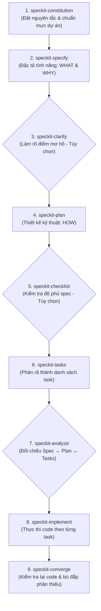

# Sổ Tay Hướng Dẫn & Ý Nghĩa Các Skills Trong Dự Án

Tài liệu này tổng hợp ý nghĩa, mục đích và cách sử dụng của toàn bộ các **Skills** hiện có trong dự án, bao gồm bộ quy trình **GitHub Spec Kit (Spec-Driven Development)**, các kỹ năng **Thiết Kế Trực Quan (baoyu-design)** và các tiện ích mở rộng.

---

## 🗺️ 1. Quy Trình Tổng Quan (Spec-Driven Development)

Thay vì viết code ngay từ đầu ("vibe-coding"), quy trình Spec Kit dẫn dắt AI đi qua các chốt kiểm soát chất lượng rõ ràng:

---

## 📋 2. Chi Tiết Ý Nghĩa Từng Nhóm Kỹ Năng

### Nhóm 1: Cốt Lõi Phát Triển Phần Mềm (Core SDD Workflow)

| Tên Skill | Lệnh Gọi | Ý Nghĩa & Mục Đích | Thời Điểm Sử Dụng | Đầu Ra / Tệp Tạo Ra |
| :--- | :--- | :--- | :--- | :--- |
| **`speckit-constitution`** | `/speckit-constitution` | **Hiến pháp dự án:** Thiết lập các nguyên tắc cốt lõi, tiêu chuẩn code, tech stack bất biến và các ràng buộc bảo mật mà AI buộc phải tuân theo. | Chạy 1 lần khi bắt đầu dự án hoặc khi thay đổi tiêu chuẩn kiến trúc lớn. | `.specify/memory/constitution.md` |
| **`speckit-specify`** | `/speckit-specify` | **Đặc tả tính năng:** Mô tả tính năng cần làm dưới góc nhìn người dùng/nghiệp vụ (*Cần làm gì? Tại sao cần làm?*), hoàn toàn không chứa chi tiết code vụn vặt. | Bắt đầu làm một tính năng mới. | `specs/<id>-<name>/spec.md` |
| **`speckit-plan`** | `/speckit-plan` | **Kế hoạch kỹ thuật:** Thiết kế giải pháp kiến trúc (*Làm như thế nào?*), chọn thư viện, thiết kế DB schema, cấu trúc API, và chiến lược test. | Ngay sau khi spec đã rõ ràng và được duyệt. | `specs/<id>-<name>/plan.md` |
| **`speckit-tasks`** | `/speckit-tasks` | **Bóc tách nhiệm vụ:** Tự động chia nhỏ bản thiết kế kỹ thuật thành danh sách các đầu việc lập trình theo thứ tự ưu tiên và phụ thuộc hợp lý. | Sau khi có `plan.md`, trước khi bắt tay vào viết code. | `specs/<id>-<name>/tasks.md` |
| **`speckit-implement`** | `/speckit-implement` | **Thực thi lập trình:** Đọc `tasks.md` và tiến hành viết code, tạo file, cấu hình và chạy test theo từng task một cách có trật tự. | Khi danh sách task đã sẵn sàng và được bạn phê duyệt. | Code thực tế trong dự án & cập nhật tiến độ vào `tasks.md`. |

---

### Nhóm 2: Tối Ưu & Đảm Bảo Chất Lượng (Quality & Verification)

| Tên Skill | Lệnh Gọi | Ý Nghĩa & Mục Đích | Thời Điểm Sử Dụng | Đầu Ra / Lợi Ích |
| :--- | :--- | :--- | :--- | :--- |
| **`speckit-clarify`** | `/speckit-clarify` | **Làm rõ yêu cầu:** Tự động quét `spec.md`, tìm ra tối đa 5 điểm chưa rõ ràng hoặc rủi ro tiềm ẩn và hỏi bạn để bổ sung vào spec. | Sau khi tạo `spec.md`, trước khi chạy `speckit-plan`. | Bổ sung câu trả lời trực tiếp vào `spec.md`. |
| **`speckit-checklist`** | `/speckit-checklist` | **Danh sách kiểm tra chất lượng:** Tạo checklist đánh giá xem spec đã đầy đủ, rõ ràng và nhất quán chưa. | Sau khi có plan, muốn rà soát lại các edge-case. | `specs/<id>-<name>/checklists/...` |
| **`speckit-analyze`** | `/speckit-analyze` | **Phân tích chéo:** Đối chiếu tính nhất quán giữa 3 tệp `spec.md`, `plan.md` và `tasks.md` xem có task nào đi lạc hướng hoặc thiếu yêu cầu so với spec ban đầu không. | Sau khi tạo `tasks.md`, trước khi gọi `speckit-implement`. | Báo cáo phân tích chất lượng và đề xuất chỉnh sửa. |
| **`speckit-converge`** | `/speckit-converge` | **Đánh giá bù đắp:** Quét codebase hiện tại đối chiếu với spec và plan, xem còn tính năng nào chưa xong để tự động bổ sung thêm task mới. | Khi vừa hoàn tất code đợt 1 hoặc muốn kiểm tra tiến độ thực tế. | Bổ sung các task còn thiếu vào `tasks.md`. |

---

### Nhóm 3: Thiết Kế Giao Diện & Trực Quan Hóa (UI/UX & Visual Design)
*(Được cài đặt từ `JimLiu/baoyu-design` - cho phép tạo sản phẩm trực quan xem ngay trên trình duyệt)*

| Tên Skill | Ý Nghĩa & Mục Đích | Khi Nào AI Tự Động Áp Dụng / Đề Xuất | Đầu Ra / Định Dạng |
| :--- | :--- | :--- | :--- |
| **`claude-design`** | **Thiết kế giao diện UI/UX nhiều màn hình:** Tạo canvas chứa các artboard giao diện dạng HTML độc lập, có thể mở lên xem cạnh nhau, chỉnh sửa copy và layout trực tiếp. | Khi bạn yêu cầu phác thảo giao diện, tạo mockup, wireframe, thiết kế trang landing page, màn hình mobile/web. | `designs/<project>/canvas.json` và các file component `.dc.html` |
| **`claude-design-system`** | **Xây dựng hệ thống nhận diện (Design System):** Định nghĩa bảng mã màu, kiểu chữ (typography), components, tokens và asset preview. | Khi bắt đầu xây dựng giao diện tổng thể hoặc cần đồng bộ phong cách thiết kế cho toàn dự án. | `project/design-system.json`, `tokens.json`, brand book. |
| **`claude-slides`** | **Soạn thảo Slide thuyết trình tương tác:** Tạo bộ trình chiếu trực tiếp bằng HTML, có chế độ thuyết trình và xuất ra PDF hoặc PowerPoint (PPTX). | Khi bạn yêu cầu làm slide báo cáo tiến độ, tài liệu thuyết trình kiến trúc hoặc giới thiệu sản phẩm. | `project/deck.json` + từng slide HTML. |
| **`claude-dashboard`** | **Tạo bảng điều khiển theo dõi số liệu (Dashboard/KPI):** Tạo trang số liệu, biểu đồ kèm thanh nguồn dữ liệu (Sources) và bộ chỉnh sửa trực tiếp (live editor). | Khi làm các tính năng thống kê, báo cáo, biểu đồ dữ liệu người dùng, quản trị thư viện. | HTML Dashboard tương tác kết nối dữ liệu CSV/JSON. |
| **`claude-whiteboard`** | **Bảng trắng phác thảo ý tưởng (Whiteboard):** Không gian vẽ sơ đồ luồng nghiệp vụ, flowchart, mindmap, so sánh phương án kiến trúc. | Khi thảo luận ý tưởng, thiết kế luồng người dùng (user flow) hoặc sơ đồ kiến trúc phức tạp. | Bản lưu trữ dạng visual board có thể kéo thả, ghi chú. |
| **`claude-motion`** & **`motion-director`** | **Tạo video hoạt ảnh UI (Motion Graphics):** Dựng video ngắn (10–30s) demo tính năng sản phẩm bằng mã code, có thể gắn kịch bản lời bình và xuất ra MP4/GIF. | Khi cần video demo tính năng nhanh, video teaser giới thiệu sản phẩm. | Player video code trực tiếp, xuất file MP4 / GIF. |
| **`dataviz`** | **Quy chuẩn đồ thị & Trực quan dữ liệu:** Cung cấp bộ công thức chọn màu sắc, cấu trúc biểu đồ (Chart/D3/Recharts/SVG) chuẩn thẩm mỹ, không bị rối mắt. | Tự động kích hoạt mỗi khi AI sắp vẽ bất kỳ biểu đồ, đồ thị hay bảng thống kê nào. | Code biểu đồ chuẩn UX và bảng màu tối ưu. |
| **`release-skills`** | **Tự động hóa phát hành phiên bản:** Tự nhận diện file version, cập nhật changelog, bump version và hỗ trợ tạo GitHub Release. | Khi bạn yêu cầu "release", "tạo phiên bản mới", "cập nhật changelog", "bump version". | Tag phiên bản, GitHub Release notes, cập nhật changelog. |
| **`impeccable`** | **Kiểm định & Tinh chỉnh Frontend Đỉnh cao (Art Director):** Chống "AI Slop", chuẩn hóa typography kinh văn, màu sắc trang nghiêm, audit khả năng tiếp cận (a11y), gọt giũa micro-interactions (`critique`, `polish`, `audit`, `harden`, `simplify`). | Tự động kích hoạt khi bắt đầu viết code giao diện thật (React/Next.js/CSS) hoặc khi yêu cầu review, gọt giũa UI. | File `DESIGN.md`, `PRODUCT.md`, báo cáo audit UX/a11y và code UI đạt chuẩn craftmanship. |

---

### Nhóm 4: Kiểm Thử, Chẩn Đoán Lỗi & Tối Ưu Code (QC, Testing & Code Review)
*(Bổ sung để hoàn thiện vai trò QC / Tester / Reviewer độc lập)*

| Tên Skill | Ý Nghĩa & Mục Đích | Thời Điểm Sử Dụng | Đầu Ra / Giá Trị Mang Lại |
| :--- | :--- | :--- | :--- |
| **`tdd`** *(Matt Pocock)* | **Kiểm thử hướng phát triển (TDD):** Viết unit test / integration test trước theo chu trình *Red-Green-Refactor* (viết test fail ➔ code vừa đủ pass ➔ refactor). | Khi bắt đầu viết logic nghiệp vụ, hàm tính toán, service hoặc API quan trọng. | Bộ test tự động (Vitest/Jest), đảm bảo không bao giờ bị vỡ logic cũ khi thêm tính năng mới. |
| **`code-review`** *(Matt Pocock)* | **Kiểm duyệt mã nguồn 2 trục:** Chạy 2 sub-agent song song để review độc lập: Trục 1 (Tuân thủ chuẩn code dự án) & Trục 2 (Khớp 100% với đặc tả `spec.md`). | Trước khi tạo commit lớn, merge branch hoặc release phiên bản. | Báo cáo review chi tiết chỉ ra các chỗ chưa đạt chuẩn hoặc thiếu yêu cầu nghiệp vụ. |
| **`diagnosing-bugs`** *(Matt Pocock)* | **Điều tra lỗi sâu (Root-cause Analysis):** Vòng lặp chẩn đoán nguyên nhân gốc rễ khi gặp bug phức tạp, chống tình trạng "đoán mò sửa bừa". | Khi gặp lỗi runtime, crash hoặc bug hành vi khó tái hiện. | Bản phân tích nguyên nhân gốc và phương án sửa chữa tối thiểu, an toàn. |
| **`vercel-react-best-practices`** | **Tối ưu hóa Next.js & React:** Áp dụng bộ quy chuẩn hiệu năng chính thức từ Vercel (RSC, Server Actions, data fetching, bundle size). | Khi viết hoặc tối ưu code React/Next.js. | Mã nguồn frontend chạy mượt, tải nhanh và không re-render thừa. |

---

### Nhóm 5: Tiện Ích Mở Rộng Hệ Sinh Thái (Ecosystem Skills)

| Tên Skill | Lệnh / Cách Dùng | Ý Nghĩa & Mục Đích |
| :--- | :--- | :--- |
| **`find-skills`** | Yêu cầu trong chat: *"Tìm skill để làm [X]..."* | **Trợ lý tìm kiếm kỹ năng:** Tra cứu trên thư viện mở [skills.sh](https://skills.sh/) của Vercel Labs để gợi ý hoặc cài đặt thêm các kỹ năng mới vào dự án. |

---

## ⚡ 3. Cơ Chế Tự Động Kích Hoạt / Đề Xuất Trong Dự Án

Để bạn làm việc thuận tiện nhất, AI sẽ tự động điều phối các skills theo ngữ cảnh yêu cầu:

1. **Khi bạn yêu cầu phát triển tính năng mới:**
   * AI sẽ tự động áp dụng quy trình SDD: `speckit-specify` ➔ `speckit-plan` ➔ `speckit-tasks` ➔ hỏi ý kiến bạn trước khi `speckit-implement`.
   * Với các module logic phức tạp: Tự động kết hợp phương pháp **`tdd`** (viết test kiểm thử trước khi code).
2. **Khi tính năng có liên quan đến Giao diện (UI/UX):**
   * AI sẽ chủ động **đề xuất tạo bản thiết kế trực quan bằng `claude-design`** để bạn xem trước màn hình trên trình duyệt trước khi viết code React/HTML.
   * Nếu có bảng số liệu/thống kê: Tự động dùng `dataviz` và `claude-dashboard`.
   * **Khi chuyển sang viết code frontend thật:** AI tự động áp dụng tiêu chuẩn của **`impeccable`** và **`vercel-react-best-practices`** để đảm bảo typography kinh văn thanh nhã, màu sắc trang nghiêm, chuẩn tương phản, tối ưu tốc độ tải trang.
3. **Khi cần kiểm tra chất lượng & rà soát code:**
   * Sử dụng **`code-review`** để đánh giá chéo giữa mã nguồn và đặc tả ban đầu.
   * Nếu có sự cố/bug: Kích hoạt **`diagnosing-bugs`** để tìm nguyên nhân gốc rễ.
4. **Khi cần giải thích luồng kiến trúc/nghiệp vụ phức tạp:**
   * AI sẽ đề xuất phác thảo sơ đồ bằng `claude-whiteboard` để hai bên cùng nhìn vào một bức tranh chung.
5. **Khi cần báo cáo hoặc trình bày:**
   * Chỉ cần nói *"Tạo slide tóm tắt tiến độ/kiến trúc..."*, AI sẽ tự động dùng `claude-slides` để xuất file thuyết trình.
