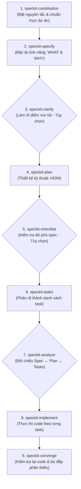

# Sổ Tay Hướng Dẫn & Ý Nghĩa Các Skills Trong Dự Án

Tài liệu này tổng hợp ý nghĩa, mục đích và cách sử dụng của toàn bộ các **Skills** hiện có trong dự án, bao gồm bộ quy trình **GitHub Spec Kit (Spec-Driven Development)** và các tiện ích mở rộng.

---

## 🗺️ Quy Trình Tổng Quan (Spec-Driven Development)

Thay vì viết code ngay từ đầu ("vibe-coding"), quy trình Spec Kit dẫn dắt AI đi qua các chốt kiểm soát chất lượng rõ ràng:

---

## 📋 Chi Tiết Ý Nghĩa Từng Skill

### 1. Nhóm Cốt Lõi (Core SDD Workflow)

| Tên Skill | Lệnh Gọi | Ý Nghĩa & Mục Đích | Thời Điểm Sử Dụng | Đầu Ra / Tệp Tạo Ra |
| :--- | :--- | :--- | :--- | :--- |
| **`speckit-constitution`** | `/speckit-constitution` | **Hiến pháp dự án:** Thiết lập các nguyên tắc cốt lõi, tiêu chuẩn code, tech stack bất biến và các ràng buộc bảo mật mà AI buộc phải tuân theo. | Chạy 1 lần khi bắt đầu dự án hoặc khi thay đổi tiêu chuẩn kiến trúc lớn. | `.specify/memory/constitution.md` |
| **`speckit-specify`** | `/speckit-specify` | **Đặc tả tính năng:** Mô tả tính năng cần làm dưới góc nhìn người dùng/nghiệp vụ (*Cần làm gì? Tại sao cần làm?*), hoàn toàn không chứa chi tiết code vụn vặt. | Bắt đầu làm một tính năng mới. | `specs/<id>-<name>/spec.md` |
| **`speckit-plan`** | `/speckit-plan` | **Kế hoạch kỹ thuật:** Thiết kế giải pháp kiến trúc (*Làm như thế nào?*), chọn thư viện, thiết kế DB schema, cấu trúc API, và chiến lược test. | Ngay sau khi spec đã rõ ràng và được duyệt. | `specs/<id>-<name>/plan.md` |
| **`speckit-tasks`** | `/speckit-tasks` | **Bóc tách nhiệm vụ:** Tự động chia nhỏ bản thiết kế kỹ thuật thành danh sách các đầu việc lập trình theo thứ tự ưu tiên và phụ thuộc hợp lý. | Sau khi có `plan.md`, trước khi bắt tay vào viết code. | `specs/<id>-<name>/tasks.md` |
| **`speckit-implement`** | `/speckit-implement` | **Thực thi lập trình:** Đọc `tasks.md` và tiến hành viết code, tạo file, cấu hình và chạy test theo từng task một cách có trật tự. | Khi danh sách task đã sẵn sàng và được bạn phê duyệt. | Code thực tế trong dự án & cập nhật tiến độ vào `tasks.md`. |

---

### 2. Nhóm Tối Ưu & Đảm Bảo Chất Lượng (Quality & Verification)

| Tên Skill | Lệnh Gọi | Ý Nghĩa & Mục Đích | Thời Điểm Sử Dụng | Đầu Ra / Lợi Ích |
| :--- | :--- | :--- | :--- | :--- |
| **`speckit-clarify`** | `/speckit-clarify` | **Làm rõ yêu cầu:** Tự động quét `spec.md`, tìm ra tối đa 5 điểm chưa rõ ràng hoặc rủi ro tiềm ẩn và hỏi bạn để bổ sung vào spec. | Sau khi tạo `spec.md`, trước khi chạy `speckit-plan`. | Bổ sung câu trả lời trực tiếp vào `spec.md`. |
| **`speckit-checklist`** | `/speckit-checklist` | **Danh sách kiểm tra chất lượng:** Tạo checklist đánh giá xem spec đã đầy đủ, rõ ràng và nhất quán chưa. | Sau khi có plan, muốn rà soát lại các edge-case. | `specs/<id>-<name>/checklists/...` |
| **`speckit-analyze`** | `/speckit-analyze` | **Phân tích chéo:** Đối chiếu tính nhất quán giữa 3 tệp `spec.md`, `plan.md` và `tasks.md` xem có task nào đi lạc hướng hoặc thiếu yêu cầu so với spec ban đầu không. | Sau khi tạo `tasks.md`, trước khi gọi `speckit-implement`. | Báo cáo phân tích chất lượng và đề xuất chỉnh sửa. |
| **`speckit-converge`** | `/speckit-converge` | **Đánh giá bù đắp:** Quét codebase hiện tại đối chiếu với spec và plan, xem còn tính năng nào chưa xong để tự động bổ sung thêm task mới. | Khi vừa hoàn tất code đợt 1 hoặc muốn kiểm tra tiến độ thực tế. | Bổ sung các task còn thiếu vào `tasks.md`. |

---

### 3. Nhóm Tiện Ích Mở Rộng Hệ Sinh Thái (Ecosystem Skills)

| Tên Skill | Lệnh / Cách Dùng | Ý Nghĩa & Mục Đích |
| :--- | :--- | :--- |
| **`find-skills`** | Yêu cầu trong chat: *"Tìm skill để làm [X]..."* | **Trợ lý tìm kiếm kỹ năng:** Tra cứu trên thư viện mở [skills.sh](https://skills.sh/) của Vercel Labs để gợi ý hoặc cài đặt thêm các kỹ năng mới (ví dụ: review PR, tối ưu SEO, viết unit test, thiết kế UI...) vào dự án. |

---

## 💡 Hướng Dẫn Sử Dụng Nhanh Hằng Ngày

### Cách 1: Tự động hoàn toàn (Khuyên dùng khi cần làm nhanh)
Bạn không cần nhớ từng lệnh, chỉ cần nhắn tin cho AI:
> *"Dùng Spec Kit để làm tính năng: [Mô tả tính năng của bạn]"*  
> ➡️ AI sẽ tự động kích hoạt tuần tự: `speckit-specify` ➔ `speckit-plan` ➔ `speckit-tasks` ➔ hỏi ý kiến bạn ➔ `speckit-implement`.

### Cách 2: Gọi từng bước (Khuyên dùng cho tính năng lớn, quan trọng)
* **Bước 1:** `/speckit-specify [mô tả]` ➔ Duyệt nội dung file `spec.md`.
* **Bước 2 (nếu cần):** `/speckit-clarify` ➔ Trả lời các câu hỏi làm rõ.
* **Bước 3:** `/speckit-plan` ➔ Duyệt giải pháp kiến trúc trong `plan.md`.
* **Bước 4:** `/speckit-tasks` ➔ Duyệt danh sách các việc cần làm trong `tasks.md`.
* **Bước 5:** `/speckit-implement` ➔ AI tiến hành code từng bước chắc chắn.

