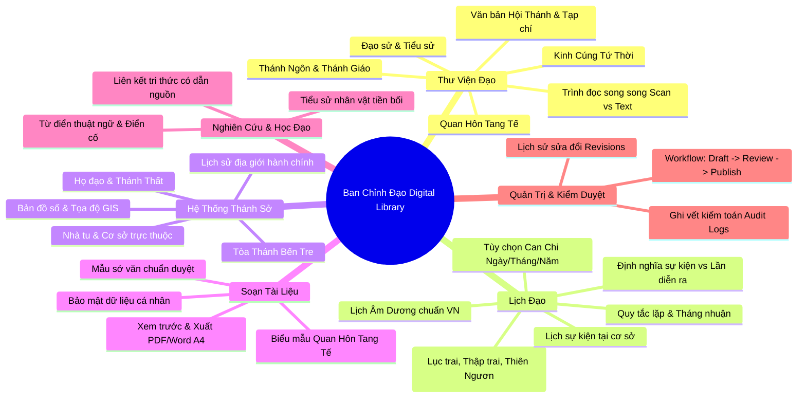

# Business Requirements Document (BRD)
## Dự án: Ban Chỉnh Đạo Digital Library (Thư viện số Cao Đài Ban Chỉnh Đạo)

| Thông tin | Chi tiết |
| :--- | :--- |
| **Mã tài liệu** | `DOC-BUS-BRD-001` |
| **Phiên bản** | `1.0.0` |
| **Trạng thái** | `PROPOSED (Chờ phê duyệt)` |
| **Ngôn ngữ chính** | Tiếng Việt |
| **Căn cứ nền tảng** | [`AGENTS.md`](../../AGENTS.md) |

---

## 1. Tầm Nhìn & Mục Tiêu Nghiệp Vụ (Product Vision & Business Objectives)

### 1.1. Tuyên bố tầm nhìn & Nhận diện thương hiệu
- **Tên hiển thị đối ngoại (User-Facing Brand):** **Thư Viện Số Cao Đài** (Tên tiếng Anh: **CaoDai Digital Library**), gắn liền với biểu tượng thiêng liêng chung là **Thiên Nhãn** và 3 màu sắc chủ đạo **Tam Giáo** (Vàng - Xanh - Đỏ).
- **Trọng tâm phát triển cốt lõi (Core Focus):** Trong giai đoạn đầu, hệ thống tập trung sâu sắc và toàn diện vào việc số hóa, tra cứu và bảo tồn kinh sách, lịch Đạo, hệ thống Thánh sở và đạo sử của **Hội Thánh Cao Đài Ban Chỉnh Đạo** (Tòa Thánh Bến Tre / An Hội).
- **Định hướng mở rộng tương lai (Branch-Ready Architecture):** Kiến trúc dữ liệu và hệ thống được thiết kế mở rộng linh hoạt (multi-organization units), cho phép tích hợp và phát triển thêm các chi phái khác của Đạo Cao Đài trong các giai đoạn tiếp theo mà không làm xáo trộn kiến trúc nền tảng.

### 1.2. Tuyên bố pháp lý & trung lập
- Nền tảng tự giới thiệu trung lập là dự án nghiên cứu, số hóa và lưu trữ tư liệu độc lập.
- Không tự tuyên bố là trang thông tin điện tử chính thức, cơ quan phát ngôn hay đại diện của Hội Thánh khi chưa có văn bản ủy quyền chính thức.
- Dữ liệu từ các Hội Thánh/chi phái Cao Đài khác chỉ được lưu ở khu vực đối chiếu/nghiên cứu riêng, gắn nhãn rõ ràng, không hiển thị như kinh văn chính thức của Ban Chỉnh Đạo.

### 1.3. Mục tiêu cụ thể
1. **Số hóa & Bảo tồn:** Lưu trữ bền vững các ấn bản Kinh Cúng Tứ Thời, Quan Hôn Tang Tế, Thánh Ngôn, Thánh Giáo, Đạo sử, Tạp chí và Văn bản Hội Thánh kèm bản scan gốc đối chiếu.
2. **Lịch Đạo chính xác & Tiện ích Trai kỳ:** Tra cứu lịch âm – dương, ngày lễ, ngày vía chuẩn xác theo múi giờ `Asia/Ho_Chi_Minh` và nguồn kiểm duyệt của Ban Chỉnh Đạo; hỗ trợ các bộ lọc hiển thị ngày ăn chay (Lục trai, Thập trai, Thiên Ngươn) và tùy chọn hiển thị Can Chi (ngày/tháng/năm).
3. **Bản đồ Thánh sở:** Định vị địa lý và lưu trữ hồ sơ, lịch sử hành chính của Tòa Thánh, Họ đạo, Thánh Thất, Nhà tu thuộc Ban Chỉnh Đạo.
4. **Hỗ trợ nghi lễ & hành chánh:** Soạn thảo, in ấn sớ văn, biểu mẫu nghi lễ theo mẫu chuẩn đã được xác minh.
5. **Nghiên cứu & Học tập:** Xây dựng từ điển thuật ngữ, tiểu sử chức sắc tiền bối có trích dẫn nguồn lưu trữ minh bạch.

---

## 2. Các Bên Liên Quan & Vai Trò Hệ Thống (Stakeholders & Scoped RBAC)

Quyền hạn trong hệ thống là **vai trò trên phần mềm**, không đại diện cho phẩm trật hay thẩm quyền tôn giáo. Áp dụng cơ chế **Scoped RBAC** (phân quyền theo phạm vi đơn vị `organization_unit` / `worship_site`):

| Vai trò (Role) | Phạm vi (Scope) | Trách nhiệm & Quyền hạn nghiệp vụ |
| :--- | :--- | :--- |
| **`VISITOR`** | Công khai | Xem kinh sách đã xuất bản, tra cứu lịch Đạo, xem bản đồ cơ sở thờ tự, tìm kiếm bài giảng/bài viết công khai. Không cần đăng nhập. |
| **`MEMBER`** | Tài khoản cá nhân | Lưu dấu trang, lịch sử đọc, tài liệu yêu thích, soạn và lưu trữ sớ văn/biểu mẫu cá nhân, gửi đề xuất đóng góp/báo sai lệch dữ liệu. |
| **`UNIT_ADMIN`** | Cơ sở cụ thể (`worship_site`) | Quản lý thông tin liên hệ, ảnh chụp, lịch sinh hoạt tại Họ đạo/Thánh Thất được giao. Không có quyền sửa đổi kinh văn hay giáo lý. |
| **`LIBRARY_EDITOR`** | Phân hệ Thư viện | Nhập metadata, tải bản scan, chạy OCR tạo bản nháp, đối chiếu bản số hóa với bản gốc, gửi duyệt ấn bản. |
| **`REVIEWER`** | Chuyên môn được giao | Thẩm định nội dung số hóa, kiểm tra nguồn gốc, phê duyệt hoặc yêu cầu chỉnh sửa tài liệu/lịch lễ/địa điểm trước khi xuất bản. |
| **`SYSTEM_ADMIN`** | Toàn hệ thống | Quản trị kỹ thuật, tài khoản người dùng, phân quyền, cấu hình hạ tầng và xem `audit_logs`. Không mặc nhiên có thẩm quyền xác nhận tính chính thống tôn giáo. |

---

## 3. 6 Phân Hệ Nghiệp Vụ Cốt Lõi (Core Business Domains)

---

## 4. Nguyên Tắc Nghiệp Vụ Tối Thượng (Business Invariants)

1. **Bản scan gốc là bằng chứng tối cao:**
   - OCR chỉ sinh văn bản nháp.
   - Không tự ý sửa lỗi chính tả, từ cổ, dấu câu, dị bản trong kinh văn nếu chưa có người có thẩm quyền phê duyệt đối chiếu.
   - Luôn hiển thị song song hoặc cho phép người dùng mở bản scan gốc để tự kiểm chứng.
2. **Trạng thái xác minh dữ liệu bắt buộc:**
   - Mọi bản ghi (tài liệu, sự kiện lịch, địa điểm) đều phải gắn 1 trong 3 trạng thái:
     * `UNVERIFIED`: Chưa xác minh (chỉ lưu nội bộ hoặc nhãn tham khảo).
     * `VERIFIED`: Đã đối chiếu với tư liệu/ấn bản đáng tin cậy.
     * `OFFICIALLY_CONFIRMED`: Có văn bản/xác nhận từ người có thẩm quyền phù hợp.
3. **Bất biến của file lưu trữ:**
   - Tệp scan gốc tải lên là bất biến (immutable). Khi cần thay thế, hệ thống tạo bản ghi phiên bản mới (`revision`), không ghi đè file cũ để bảo toàn tính toàn vẹn lịch sử.
4. **Không suy diễn giáo lý/kinh văn:**
   - Không dùng AI để tự sáng tác, diễn giải kinh văn hoặc tự suy diễn ngày lễ. AI chỉ phục vụ tìm kiếm, OCR bản nháp và định dạng văn bản.

