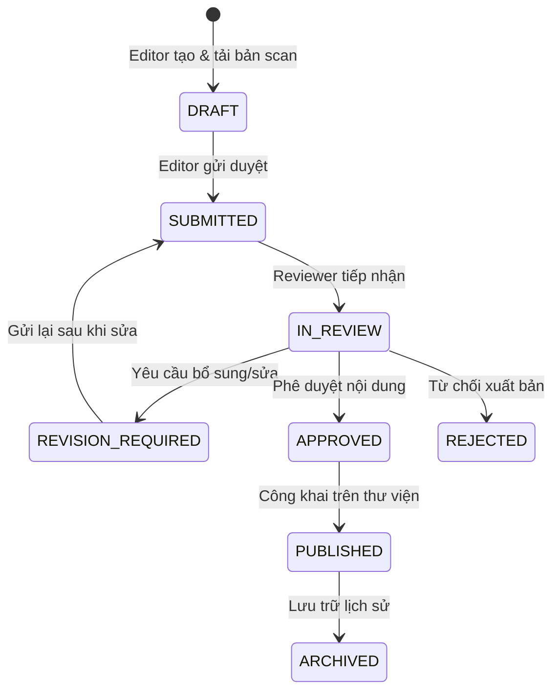

# Business Rules & Logic Conventions
## Dự án: Ban Chỉnh Đạo Digital Library

| Thông tin | Chi tiết |
| :--- | :--- |
| **Mã tài liệu** | `DOC-BUS-RULES-001` |
| **Phiên bản** | `1.0.0` |
| **Trạng thái** | `PROPOSED` |

---

## 1. Quy Tắc Nghiệp Vụ Phân Hệ Thư Viện Đạo (Library Rules)

### BR-LIB-01: Phân tách Thực thể Tài liệu
- Hệ thống phân biệt rõ 3 cấp độ:
  1. **Tác phẩm / Đầu mục (`Document`):** Tên chung (ví dụ: *Kinh Cúng Tứ Thời*).
  2. **Ấn bản (`DocumentEdition`):** Một lần xuất bản cụ thể gắn với năm, nhà in, lần tái bản (ví dụ: *Bản in năm 1968 tại Tòa Thánh Bến Tre* vs *Bản in năm 1995*).
  3. **Tệp tin (`DocumentFile`):** File scan gốc (PDF/ảnh), file PDF tối ưu hiển thị, hoặc file âm thanh tụng kinh kèm theo.
- **Quy tắc:** Một tác phẩm có thể có nhiều ấn bản; một ấn bản có thể có nhiều tệp tin. Không tự ý hợp nhất các ấn bản khác nhau thành một.

### BR-LIB-02: Quy trình Xuất bản Tài liệu (Editorial Workflow)
Trạng thái tài liệu bắt buộc chuyển dịch tuần tự:

- Người dùng công khai (`VISITOR`) chỉ được xem tài liệu ở trạng thái `PUBLISHED`.

---

## 2. Quy Tắc Nghiệp Vụ Phân Hệ Lịch Đạo (Calendar Rules)

### BR-CAL-01: Tách biệt Định nghĩa Sự kiện & Lần diễn ra
- **Định nghĩa sự kiện (`ReligiousEvent`):** Lưu quy tắc tổng quát (Tên ngày lễ, Ngày âm: Ngày 15 tháng 10, quy tắc lặp hằng năm, mô tả ý nghĩa, nguồn chứng cứ).
- **Lần diễn ra cụ thể (`EventOccurrence`):** Tính toán ngày dương lịch cụ thể cho một năm dương lịch nhất định dựa trên thuật toán âm lịch Việt Nam (múi giờ `Asia/Ho_Chi_Minh` UTC+7).
- **Cấm:** Không bao giờ hard-code ngày dương cố định cho các ngày lễ âm lịch lặp hằng năm.

### BR-CAL-02: Quy tắc Nhuận & Lặp lại
- Lịch âm Việt Nam có tháng nhuận. Quy tắc sự kiện phải khai báo rõ: *Có áp dụng cho tháng nhuận hay không?* (Mặc định: Các ngày lễ vía lớn chỉ cúng vào tháng chính, trừ khi có văn bản quy định riêng của Hội Thánh).

### BR-CAL-03: Quy tắc Các Ngày Ăn Chay (Trai Kỳ)
Hệ thống hỗ trợ 3 chế độ hiển thị ngày ăn chay (người dùng có thể bật/tắt hoặc chọn chế độ hiển thị trên giao diện):
1. **Lục trai (6 ngày chay mỗi tháng):**
   * *Tháng đủ (30 ngày):* Ngày mùng 8, 14, 15, 23, 29, 30 âm lịch.
   * *Tháng thiếu (29 ngày):* Ngày mùng 8, 14, 15, 23, 28, 29 âm lịch (dời 2 ngày cuối lên 28, 29).
2. **Thập trai (10 ngày chay mỗi tháng):**
   * *Tháng đủ (30 ngày):* Ngày mùng 1, 8, 14, 15, 18, 23, 24, 28, 29, 30 âm lịch.
   * *Tháng thiếu (29 ngày):* Ngày mùng 1, 8, 14, 15, 18, 23, 24, 27, 28, 29 âm lịch (dời 3 ngày cuối lên 27, 28, 29).
3. **Ăn chay Thiên Ngươn (Tam Ngươn Trai Kỳ):**
   * Là 3 mùa ăn chay lớn theo quy định giáo luật:
     - *Thượng Ngươn:* Trọn tháng Giêng (từ mùng 1 đến hết ngày 30/29 tháng Giêng âm lịch).
     - *Trung Ngươn:* Trọn tháng 7 (từ mùng 1 đến hết ngày 30/29 tháng 7 âm lịch).
     - *Hạ Ngươn:* Trọn tháng 10 (từ mùng 1 đến hết ngày 30/29 tháng 10 âm lịch).
     *(Ghi chú: Quy tắc chi tiết của từng kỳ Thiên Ngươn có thể tinh chỉnh theo văn bản quy chế chính thức của Ban Chỉnh Đạo).*
4. **Hiển thị trực quan:**
   * Các ngày chay được đánh dấu bằng ký hiệu/icon hoa sen hoặc màu sắc nhã nhặn (tôn trọng nguyên tắc trang nghiêm, không lòe loẹt).
   * Lựa chọn chế độ ăn chay được lưu trong `user_calendar_preferences` (đối với tài khoản đăng nhập) hoặc `localStorage` (đối với khách vãng lai).

### BR-CAL-04: Quy tắc Tính Toán & Hiển Thị Can Chi
1. **Thuật toán Can Chi chuẩn:**
   * Tính toán chính xác 10 Thiên Can (Giáp, Ất, Bính, Đinh, Mậu, Kỷ, Canh, Tân, Nhâm, Quý) kết hợp 12 Địa Chi (Tý, Sửu, Dần, Mão, Thìn, Tỵ, Ngọ, Mùi, Thân, Dậu, Tuất, Hợi) tạo thành chu kỳ Lục Thập Hoa Giáp (60 hoa giáp).
   * Múi giờ chuẩn: `Asia/Ho_Chi_Minh` (UTC+7). Mốc chuyển ngày âm lịch tính từ 00:00 giờ (giờ Tý bắt đầu từ 23:00 hôm trước).
2. **Chế độ hiển thị:**
   * Cung cấp nút chuyển đổi (toggle) **"Hiển thị Can Chi"**.
   * Khi bật:
     - Ô ngày hiển thị **Can Chi của Ngày** (ví dụ: *Giáp Tý*).
     - Đầu tháng hiển thị **Can Chi của Tháng** (ví dụ: *Tháng Bính Dần*).
     - Đầu năm hiển thị **Can Chi của Năm** (ví dụ: *Năm Bính Ngọ*).
   * Khi tắt: Chỉ hiển thị số ngày Dương và số ngày Âm để giao diện tối giản, thoáng đãng.

---

## 3. Quy Tắc Nghiệp Vụ Phân Hệ Tổ Đình & Thánh Sở (Core Complex & Worship Sites Rules)

### BR-SITE-01: Phân tách Đơn vị Tổ chức & Địa điểm Vật lý
- **Đơn vị tổ chức (`OrganizationUnit`):** Cây tổ chức tôn giáo cha-con (Hội Thánh ➔ Ban Trị Sự / Họ đạo).
- **Địa điểm vật lý (`WorshipSite`):** Cơ sở công trình cụ thể (Tòa Thánh, Điện Thờ Phật Mẫu, Nhà Tu Trung Thừa, Nhà Tu Thượng Thừa, Thánh Thất, Nhà tu khác).
- Một đơn vị tổ chức có thể quản lý một hoặc nhiều địa điểm vật lý.

### BR-SITE-02: Lịch sử Địa giới Hành chính
- Đơn vị hành chính của Việt Nam có sự sáp nhập, đổi tên theo thời kỳ lịch sử.
- **Quy tắc:** Hệ thống lưu song song `Địa chỉ hiện hành` (phục vụ chỉ đường đến Tổ Đình) và `Địa chỉ lịch sử / Địa danh thời điểm hình thành` (phục vụ đối chiếu văn bản cổ). Không được ghi đè làm mất địa danh lịch sử.

### BR-SITE-03: Phân tầng Hiển Thị & Bảo Mật Thông Tin Thánh Sở
- Vì lý do bảo mật và quyền riêng tư của các cơ sở địa phương, hệ thống **không** công khai danh bạ chi tiết hay bản đồ GIS toàn bộ hơn 200 Thánh Thất.
- Áp dụng trường `visibility_level` trên `WorshipSite`:
  * `PUBLIC_FEATURED`: Các công trình trọng tâm tại Tổ Đình Bến Tre (**Tòa Thánh Bến Tre**, **Điện Thờ Phật Mẫu**, **Nhà Tu Trung Thừa**, **Nhà Tu Thượng Thừa**) được giới thiệu chi tiết công khai.
  * `PUBLIC_COMPACT`: Các Thánh Thất/cơ sở tiêu biểu được phép công khai chỉ hiển thị ở dạng **mục thu gọn** (tên, tỉnh/thành, địa chỉ khái quát đã kiểm chứng), không phô bày dữ liệu nhạy cảm hay bản đồ chi tiết toàn mạng lưới.
  * `INTERNAL_ONLY`: Dữ liệu danh bạ đầy đủ, thông tin liên hệ nội bộ hoặc cơ sở chưa xác minh chỉ hiển thị cho vai trò được phân quyền (`UNIT_ADMIN`, `REVIEWER`, `SYSTEM_ADMIN` trong phạm vi được giao).

### BR-SITE-04: Cấu Trúc Nội Dung Chuẩn Cho Cụm Công Trình Trọng Tâm
- Mỗi công trình trọng tâm tại Tổ Đình Bến Tre (`is_featured_landmark = true`) phải được tổ chức nội dung có cấu trúc rõ ràng gồm 3 trụ cột (`SiteSectionType`):
  1. `HISTORY` (**Lịch sử**): Nguồn gốc hình thành, các mốc thời gian lịch sử, sự kiện gắn liền, kèm trích dẫn nguồn tài liệu.
  2. `ARCHITECTURE` (**Xây dựng & Kiến trúc**): Quá trình xây dựng, trùng tu, đặc điểm kiến trúc, bài trí thờ tự.
  3. `DIRECTIONS` (**Đường đi đến**): Địa chỉ hiện hành, tọa độ/chỉ dẫn đường đi đến, lưu ý tiếp đón/tham quan (nếu có xác minh).
- Các thông tin chưa có nguồn kiểm chứng phải gắn trạng thái `PENDING_VERIFICATION`, tuyệt đối không suy diễn hoặc bịa đặt số liệu lịch sử/kiến trúc.

---

## 4. Quy Tắc Nghiệp Vụ Phân Hệ Soạn Tài Liệu (Composer Rules)

### BR-DOC-01: Quản lý Phiên bản Biểu mẫu
- Sớ văn và biểu mẫu nghi lễ phải gắn với `TemplateVersion` đã được kiểm duyệt.
- Người dùng khi nhập dữ liệu sẽ kế thừa chính xác cấu trúc trường của phiên bản biểu mẫu được áp dụng tại thời điểm đó.

### BR-DOC-02: Quyền Riêng Tư Tài Liệu Cá Nhân
- Dữ liệu sớ văn chứa thông tin cá nhân (Họ tên, tuổi tác, địa chỉ gia quyến tín đồ).
- **Quy tắc:** Dữ liệu này thuộc quyền riêng tư tuyệt đối của tài khoản tạo ra (`MEMBER`). `SYSTEM_ADMIN` và người dùng khác không được xem trừ khi người tạo chủ động chia sẻ hoặc gửi vào ban lễ vụ của cơ sở.

