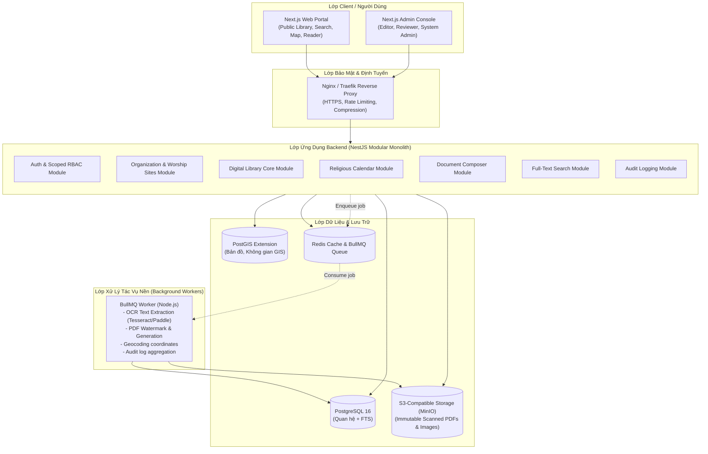

# Solution Architecture Document
## Dự án: Ban Chỉnh Đạo Digital Library

| Thông tin | Chi tiết |
| :--- | :--- |
| **Mã tài liệu** | `DOC-ARCH-SYS-001` |
| **Phiên bản** | `1.0.0` |
| **Mô hình kiến trúc** | **Modular Monolith** |
| **Căn cứ** | [`AGENTS.md`](../../AGENTS.md) Mục 6 |

---

## 1. Sơ Đồ Kiến Trúc Tổng Thể (System Architecture Diagram)

Hệ thống được thiết kế theo mô hình **Modular Monolith** nhằm cân bằng giữa tính đơn giản khi triển khai vận hành và khả năng phân tách ranh giới module rõ ràng, sẵn sàng mở rộng trong tương lai.

---

## 2. Kiến Trúc Chi Tiết Từng Lớp

### 2.1. Lớp Frontend (Web & Admin Portal)
- **Công nghệ:** Next.js (App Router), TypeScript, Tailwind CSS.
- **Thư viện giao diện:** Radix UI / Shadcn UI (ưu tiên ngữ nghĩa semantic, độ tương phản cao, hỗ trợ a11y theo quy chuẩn `impeccable`).
- **Thư viện Bản đồ:** MapLibre GL JS (mã nguồn mở, không phụ thuộc chi phí Google Maps API).
- **Bộ đọc tài liệu (Reader):**
  * Chế độ 1: Tệp Scan gốc PDF (PDF.js canvas rendering, hỗ trợ zoom, xoay trang).
  * Chế độ 2: Bản văn điện tử (Typography chuẩn cho tiếng Việt cổ, Hán-Nôm unicode, điều chỉnh font size, mục lục chương/bài).
  * Chế độ 3: Xem song song đối chiếu (Split view: Trái là scan gốc, Phải là văn bản đã biên tập).

### 2.2. Lớp Backend (NestJS Modular Monolith)
Backend chia thành các module nghiệp vụ độc lập, giao tiếp thông qua Service Interface hoặc Event Bus nội bộ:
* `auth`: Đăng ký, đăng nhập JWT/Session, mã hóa mật khẩu bằng Argon2/Bcrypt.
* `access-control`: Scoped RBAC Guard (kiểm tra vai trò và phạm vi `unit_id` trên từng endpoint).
* `organization`: Quản lý hồ sơ tổ chức và cây đơn vị trực thuộc.
* `worship-sites`: Quản lý các cơ sở thờ tự, tọa độ PostGIS, ảnh và lịch sử hành chính.
* `library`: Quản lý tác phẩm, ấn bản, file scan, mục lục, nội dung và workflow xuất bản.
* `calendar`: Thuật toán âm lịch Việt Nam, định nghĩa ngày lễ, lần diễn ra sự kiện.
* `document-composer`: Mẫu văn bản, kiểm tra trường dữ liệu, tạo file Word/PDF.
* `audit`: Tự động ghi lại hành động của người dùng (Who, When, What, Old Value, New Value, IP).

### 2.3. Lớp Dữ Liệu & Lưu Trữ
- **PostgreSQL 16 + PostGIS:** Lưu trữ toàn bộ dữ liệu quan hệ, dữ liệu không gian tọa độ các cơ sở (`ST_Point`), và Full-Text Search tiếng Việt (`tsvector`).
- **MinIO / S3-compatible Object Storage:**
  * File gốc bất biến (bản scan PDF/JPG chất lượng cao).
  * File sinh ra (PDF tối ưu dung lượng, file DOCX tạo ra từ Composer).
- **Redis:** Lưu Cache phiên đăng nhập, Rate Limiting và hàng đợi tác vụ nặng cho BullMQ.

