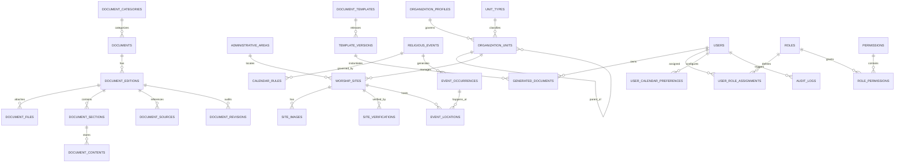

# Database Schema & Data Model Design

## Dự án: Ban Chỉnh Đạo Digital Library

| Thông tin                     | Chi tiết                                                                                          |
| :----------------------------- | :------------------------------------------------------------------------------------------------- |
| **Mã tài liệu**       | `DOC-DB-SCHEMA-001`                                                                              |
| **Hệ quản trị CSDL**  | **PostgreSQL 16 + PostGIS Extension**                                                        |
| **ORM dự kiến**        | Prisma                                                                                             |
| **Quy ước đặt tên** | Bảng: `snake_case` số nhiều; Cột: `snake_case`; Khóa chính: `id` (UUIDv7 hoặc BigInt) |

---

## 1. Sơ Đồ Thực Thể Liên Kết (Entity Relationship Diagram - ERD)

---

## 2. Chi Tiết Các Bảng Dữ Liệu Theo Domain

### Domain 1: Người dùng, Phân quyền & Kiểm duyệt (Auth & Scoped RBAC)

#### Bảng `users`

| Cột              | Kiểu            | Ràng buộc                       | Mô tả                                          |
| :---------------- | :--------------- | :-------------------------------- | :----------------------------------------------- |
| `id`            | `UUID`         | PK, Default `gen_random_uuid()` | Định danh người dùng                        |
| `email`         | `VARCHAR(255)` | UNIQUE, NOT NULL                  | Địa chỉ email đăng nhập                    |
| `password_hash` | `VARCHAR(255)` | NOT NULL                          | Mật khẩu băm (Argon2id)                       |
| `full_name`     | `VARCHAR(150)` | NOT NULL                          | Họ tên đầy đủ                              |
| `phone_number`  | `VARCHAR(20)`  | NULL                              | Số điện thoại (bảo mật, không công khai) |
| `status`        | `VARCHAR(30)`  | Default `'ACTIVE'`              | `ACTIVE`, `SUSPENDED`, `INACTIVE`          |
| `created_at`    | `TIMESTAMPTZ`  | Default `NOW()`                 | Thời điểm tạo                                |
| `updated_at`    | `TIMESTAMPTZ`  | Default `NOW()`                 | Thời điểm cập nhật                          |
| `deleted_at`    | `TIMESTAMPTZ`  | NULL                              | Soft delete timestamp                            |

#### Bảng `roles` & `permissions`

- `roles`: `id`, `code` (`VISITOR`, `MEMBER`, `UNIT_ADMIN`, `LIBRARY_EDITOR`, `REVIEWER`, `SYSTEM_ADMIN`), `name`, `description`.
- `permissions`: `id`, `code` (ví dụ: `document.create`, `document.publish`, `site.edit`), `module`.
- `role_permissions`: Liên kết `role_id` và `permission_id`.

#### Bảng `user_role_assignments` (Scoped RBAC)

| Cột              | Kiểu           | Ràng buộc                           | Mô tả                                       |
| :---------------- | :-------------- | :------------------------------------ | :-------------------------------------------- |
| `id`            | `UUID`        | PK                                    | Khóa chính                                  |
| `user_id`       | `UUID`        | FK -> `users.id`, NOT NULL          | Người dùng được gán                    |
| `role_id`       | `UUID`        | FK -> `roles.id`, NOT NULL          | Vai trò                                      |
| `scope_unit_id` | `UUID`        | FK -> `organization_units.id`, NULL | Đơn vị áp dụng (NULL = toàn hệ thống) |
| `scope_site_id` | `UUID`        | FK -> `worship_sites.id`, NULL      | Cơ sở áp dụng (nếu là UNIT_ADMIN)       |
| `assigned_by`   | `UUID`        | FK -> `users.id`                    | Người thực hiện phân quyền              |
| `created_at`    | `TIMESTAMPTZ` | Default `NOW()`                     | Ngày gán quyền                             |

---

### Domain 2: Tổ Đình Bến Tre & Cơ Sở Thờ Tự (Core Sacred Complex & Compact Directory)

#### Bảng `organization_units` (Cây đơn vị cha-con)

- `id` (UUID), `parent_id` (FK tự liên kết cho quan hệ cha-con), `name` (Tên đơn vị, ví dụ: *Hội Thánh Cao Đài Ban Chỉnh Đạo*, *Họ Đạo An Hội*), `unit_type` (`HOI_THANH`, `BAN_TRI_SU`, `HO_DAO`, `OTHER`), `established_year`, `created_at`, `updated_at`.

#### Bảng `worship_sites` (Địa điểm thờ tự & Công trình trọng tâm)

| Cột | Kiểu | Ràng buộc | Mô tả |
| :--- | :--- | :--- | :--- |
| `id` | `UUID` | PK | Khóa chính |
| `org_unit_id` | `UUID` | FK -> `organization_units.id`, NULL | Đơn vị quản lý cơ sở |
| `slug` | `VARCHAR(120)` | UNIQUE, NOT NULL | Định danh URL (vd: `toa-thanh-ben-tre`, `dien-tho-phat-mau`) |
| `name` | `VARCHAR(200)` | NOT NULL | Tên công trình/cơ sở |
| `other_names` | `TEXT[]` | NULL | Các tên gọi lịch sử khác (vd: *Diêu Trì Bửu Điện*, *Tòa Thánh An Hội*) |
| `site_type` | `VARCHAR(50)` | NOT NULL | `TOA_THANH`, `DIEN_THO_PHAT_MAU`, `NHA_TU_TRUNG_THUA`, `NHA_TU_THUONG_THUA`, `THANH_THAT`, `HO_DAO`, `OTHER_SITE` |
| `is_featured_landmark` | `BOOLEAN` | Default `false` | `true` đối với 4 công trình trọng tâm tại Tổ Đình Bến Tre |
| `visibility_level` | `VARCHAR(30)` | Default `'INTERNAL_ONLY'` | `PUBLIC_FEATURED`, `PUBLIC_COMPACT`, `INTERNAL_ONLY` (phân tầng bảo mật) |
| `display_order` | `INT` | Default `0` | Thứ tự hiển thị ưu tiên |
| `province` | `VARCHAR(100)` | NULL | Tỉnh/Thành phố hiện hành |
| `current_address` | `TEXT` | NOT NULL | Địa chỉ hiện hành |
| `historic_address` | `TEXT` | NULL | Địa chỉ thời kỳ đầu / lịch sử |
| `directions_summary` | `TEXT` | NULL | Tóm tắt chỉ dẫn đường đi đến (dành cho công trình công khai) |
| `latitude` | `DOUBLE PRECISION` | NULL | Vĩ độ (chỉ công khai cho `PUBLIC_FEATURED`) |
| `longitude` | `DOUBLE PRECISION` | NULL | Kinh độ (chỉ công khai cho `PUBLIC_FEATURED`) |
| `verification_status` | `VARCHAR(30)` | Default `'PENDING_VERIFICATION'` | `UNVERIFIED`, `PENDING_VERIFICATION`, `VERIFIED`, `OFFICIALLY_CONFIRMED` |
| `source_note` | `TEXT` | NULL | Nguồn tài liệu đối chiếu |
| `verified_by` | `UUID` | FK -> `users.id`, NULL | Người thực hiện thẩm định |
| `verified_at` | `TIMESTAMPTZ` | NULL | Thời điểm thẩm định |
| `created_at`, `updated_at`, `deleted_at` | `TIMESTAMPTZ` | Chuẩn audit | |

#### Bảng `site_detail_sections` (Nội dung Lịch sử – Xây dựng – Đường đi đến)

Lưu trữ nội dung chuyên sâu theo từng trụ cột cho 4 công trình trọng tâm tại Tổ Đình Bến Tre (`Tòa Thánh Bến Tre`, `Điện Thờ Phật Mẫu`, `Nhà Tu Trung Thừa`, `Nhà Tu Thượng Thừa`):

| Cột | Kiểu | Ràng buộc | Mô tả |
| :--- | :--- | :--- | :--- |
| `id` | `UUID` | PK | Khóa chính |
| `site_id` | `UUID` | FK -> `worship_sites.id`, NOT NULL | Công trình tương ứng |
| `section_type` | `VARCHAR(30)` | NOT NULL | `HISTORY` (Lịch sử), `ARCHITECTURE` (Xây dựng), `DIRECTIONS` (Đường đi đến) |
| `title` | `VARCHAR(200)` | NOT NULL | Tiêu đề mục con |
| `content_markdown` | `TEXT` | NOT NULL | Nội dung chi tiết (hỗ trợ Markdown) |
| `sort_order` | `INT` | Default `0` | Thứ tự sắp xếp trong cùng nhóm |
| `source_citation` | `TEXT` | NULL | Trích dẫn nguồn tư liệu |
| `verification_status` | `VARCHAR(30)` | Default `'PENDING_VERIFICATION'` | `UNVERIFIED`, `PENDING_VERIFICATION`, `VERIFIED`, `OFFICIALLY_CONFIRMED` |
| `created_at`, `updated_at` | `TIMESTAMPTZ` | Chuẩn audit | |

---

### Domain 3: Thư Viện Đạo (Digital Library Core)

#### Bảng `documents` (Tác phẩm)

- `id` (UUID), `title` (Tên tác phẩm, vd: *Kinh Cúng Tứ Thời*), `category_id` (FK), `author_or_source` (Tác giả/Nguồn ban hành), `summary` (Tóm tắt), `created_at`, `updated_at`.

#### Bảng `document_editions` (Ấn bản cụ thể)

| Cột                    | Kiểu            | Ràng buộc                      | Mô tả                                                                            |
| :---------------------- | :--------------- | :------------------------------- | :--------------------------------------------------------------------------------- |
| `id`                  | `UUID`         | PK                               | Khóa chính ấn bản                                                              |
| `document_id`         | `UUID`         | FK -> `documents.id`, NOT NULL | Thuộc tác phẩm nào                                                             |
| `edition_name`        | `VARCHAR(150)` | NOT NULL                         | Tên ấn bản (vd: *Bản in Bến Tre 1968*)                                      |
| `publication_year`    | `INT`          | NULL                             | Năm phát hành                                                                   |
| `publisher`           | `VARCHAR(200)` | NULL                             | Nhà in / Cơ quan ấn hành                                                       |
| `status`              | `VARCHAR(30)`  | Default `'DRAFT'`              | `DRAFT`, `SUBMITTED`, `IN_REVIEW`, `APPROVED`, `PUBLISHED`, `ARCHIVED` |
| `verification_status` | `VARCHAR(30)`  | Default `'UNVERIFIED'`         | `UNVERIFIED`, `VERIFIED`, `OFFICIALLY_CONFIRMED`                             |
| `published_at`        | `TIMESTAMPTZ`  | NULL                             | Ngày phát hành công khai                                                       |
| `created_by`          | `UUID`         | FK -> `users.id`               | Người tạo bản nháp                                                            |

#### Bảng `document_files` (Tệp đính kèm)

- `id` (UUID), `edition_id` (FK), `file_type` (`SCAN_ORIGINAL_PDF`, `OPTIMIZED_PDF`, `AUDIO_MP3`, `IMAGE_COVER`), `storage_path` (Đường dẫn MinIO/S3), `checksum_sha256` (Mã kiểm tra toàn vẹn file), `file_size_bytes`, `created_at`.

#### Bảng `document_sections` & `document_contents` (Mục lục & Bản văn biên tập)

- `document_sections`: `id`, `edition_id` (FK), `parent_id` (Chương/Mục phân cấp), `title` (Tên bài kinh/chương), `order_index`, `page_number_start`.
- `document_contents`: `id`, `section_id` (FK), `content_text` (Văn bản đã biên tập), `original_scan_page_ref` (Trang scan đối chiếu), `search_vector` (`tsvector` cho tìm kiếm toàn văn tiếng Việt).

---

### Domain 4: Lịch Đạo & Trai Kỳ (Calendar & Fasting Domain)

#### Bảng `religious_events` (Định nghĩa sự kiện)
- `id` (UUID), `name` (Tên ngày lễ/vía, vd: *Đại Lễ Khai Đạo*), `lunar_day` (Ngày âm: 15), `lunar_month` (Tháng âm: 10), `is_leap_month_applicable` (Boolean), `recurrence_type` (`ANNUAL`, `ONCE`, `MONTHLY_TRAM_SOC`), `description`, `source_reference`.

#### Bảng `event_occurrences` (Lần diễn ra theo ngày & Dữ liệu Thiên văn / Can Chi)
| Cột | Kiểu | Ràng buộc | Mô tả |
| :--- | :--- | :--- | :--- |
| `id` | `UUID` | PK | Khóa chính |
| `event_id` | `UUID` | FK -> `religious_events.id`, NULL | Sự kiện lễ nếu có |
| `solar_date` | `DATE` | NOT NULL, INDEX | Ngày dương lịch (vd: `2026-11-24`) |
| `lunar_day` | `INT` | NOT NULL | Ngày âm lịch (1 - 30) |
| `lunar_month` | `INT` | NOT NULL | Tháng âm lịch (1 - 12) |
| `lunar_year` | `INT` | NOT NULL | Năm âm lịch |
| `is_leap_month` | `BOOLEAN`| Default `false` | Có phải tháng âm nhuận không |
| `can_chi_day` | `VARCHAR(30)` | NOT NULL | Can Chi Ngày (vd: *Canh Thân*) |
| `can_chi_month`| `VARCHAR(30)` | NOT NULL | Can Chi Tháng (vd: *Kỷ Hợi*) |
| `can_chi_year` | `VARCHAR(30)` | NOT NULL | Can Chi Năm (vd: *Bính Ngọ*) |
| `is_luc_trai` | `BOOLEAN` | Default `false` | Có phải ngày Lục trai không (mùng 8, 14, 15, 23, 29, 30) |
| `is_thap_trai`| `BOOLEAN` | Default `false` | Có phải ngày Thập trai không (1, 8, 14, 15, 18, 23, 24, 28, 29, 30) |
| `is_thien_nguon`| `BOOLEAN`| Default `false` | Có thuộc mùa ăn chay Thiên Ngươn không |
| `status` | `VARCHAR(30)` | Default `'CONFIRMED'` | `CONFIRMED`, `TENTATIVE` |

#### Bảng `user_calendar_preferences` (Tùy chọn hiển thị Lịch của Người dùng)
| Cột | Kiểu | Ràng buộc | Mô tả |
| :--- | :--- | :--- | :--- |
| `id` | `UUID` | PK | Khóa chính |
| `user_id` | `UUID` | FK -> `users.id`, UNIQUE | Thuộc tài khoản nào |
| `show_can_chi` | `BOOLEAN` | Default `true` | Bật/Tắt hiển thị Can Chi trên ô lịch |
| `fasting_schedule` | `VARCHAR(30)` | Default `'NONE'` | `NONE`, `LUC_TRAI`, `THAP_TRAI`, `THIEN_NGUON` |
| `highlight_tram_soc` | `BOOLEAN` | Default `true` | Nổi bật ngày Sóc Vọng (Mùng 1 & Rằm) |
| `updated_at` | `TIMESTAMPTZ` | Default `NOW()` | Thời điểm cập nhật tùy chọn |
*(Ghi chú: Đối với người dùng chưa đăng nhập `VISITOR`, các tùy chọn này được lưu trong `localStorage` phía Frontend)*.

---

### Domain 5: Soạn Tài Liệu (Document Composer)

#### Bảng `document_templates` & `template_versions`

- `document_templates`: `id`, `name` (Vd: *Sớ Cầu Siêu Tuần Cửu*), `type` (`SO_VAN`, `BIEU_MAU_HANH_CHANH`), `created_at`.
- `template_versions`: `id`, `template_id` (FK), `version_number` (`1.0`, `1.1`), `schema_json` (Định nghĩa các trường nhập dữ liệu), `template_docx_path` (File mẫu gốc), `status` (`ACTIVE`, `DEPRECATED`).

#### Bảng `generated_documents` (Tài liệu do người dùng tạo)

- `id` (UUID), `user_id` (FK -> `users.id`), `template_version_id` (FK), `title`, `form_data_json` (Dữ liệu người dùng nhập), `exported_file_path` (PDF/Word đã xuất), `created_at`.

---

### Domain 6: Kiểm Toán Hệ Thống (Audit Logging)

#### Bảng `audit_logs`

- `id` (UUID), `user_id` (FK, NULL nếu hệ thống), `action` (`CREATE`, `UPDATE`, `DELETE`, `PUBLISH`, `LOGIN`), `entity_name` (`worship_sites`, `document_editions`...), `entity_id` (UUID của bản ghi bị tác động), `old_values_json`, `new_values_json`, `ip_address`, `user_agent`, `created_at`.
