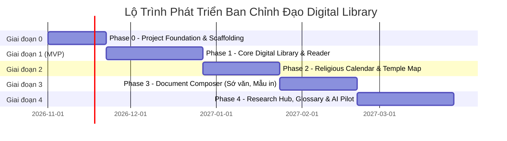

# Development Roadmap & MVP Phasing Strategy
## Dự án: Ban Chỉnh Đạo Digital Library

| Thông tin | Chi tiết |
| :--- | :--- |
| **Mã tài liệu** | `DOC-PLAN-ROADMAP-001` |
| **Phiên bản** | `1.0.0` |
| **Chiến lược tiếp cận** | **Vertical Slices (Hoàn thành & kiểm thử từng phân hệ trước khi chuyển bước)** |

---

## 🚀 1. Lộ Trình Triển Khai 5 Giai Đoạn (Phased Roadmap)

---

## 📌 2. Chi Tiết Từng Giai Đoạn

### 🟢 Phase 0: Project Foundation (Thiết Lập Nền Tảng)
* **Mục tiêu:** Dựng khung dự án chuẩn mực, cấu hình CI/CD, cơ sở dữ liệu và bảo mật nền tảng.
* **Các thành phần thực hiện:**
  - Khởi tạo monorepo/modular repo với Next.js (Frontend) và NestJS (Backend).
  - Cấu hình PostgreSQL 16 + PostGIS qua Docker Compose.
  - Thiết lập Prisma ORM, migrations nền tảng (`users`, `roles`, `permissions`, `audit_logs`).
  - Triển khai cơ chế xác thực JWT + Scoped RBAC Guard.
  - Tích hợp MinIO Object Storage cho lưu trữ tệp tin.
* **Tiêu chí nghiệm thu (Acceptance Criteria):**
  - Chạy `docker compose up` khởi động đầy đủ Postgres, Redis, MinIO, API và Web thành công.
  - Đăng ký, đăng nhập tài khoản, phân quyền Scoped RBAC hoạt động và có kiểm thử tự động (Unit Test / Integration Test).

---

### 🟡 Phase 1: Core Digital Library (Phân Hệ Thư Viện Trọng Tâm - MVP)
* **Mục tiêu:** Cung cấp trải nghiệm đọc kinh sách, tra cứu tài liệu số hóa pilot cho Hội Thánh Cao Đài Ban Chỉnh Đạo.
* **Bộ dữ liệu Pilot:** Ấn bản chuẩn của *Kinh Cúng Tứ Thời* và *Quan Hôn Tang Tế*.
* **Các tính năng:**
  - **Admin:** Quản lý danh mục, tác phẩm, ấn bản, tải tệp scan gốc, quản lý workflow xuất bản (`DRAFT` ➔ `REVIEW` ➔ `PUBLISHED`).
  - **Biên tập:** Mục lục phân cấp, nhập nội dung văn bản đối chiếu với số trang bản scan.
  - **Portal công chúng:** Danh mục kinh sách, tìm kiếm toàn văn tiếng Việt có dấu, bộ đọc Reader song song (Split-view: Scan PDF đối chiếu vs Bản văn điện tử).
* **Tiêu chí nghiệm thu:**
  - Người dùng công khai tra cứu và đọc được trọn vẹn bộ kinh pilot với độ hiển thị rõ nét trên cả Desktop và Mobile.
  - Phân quyền chặt chẽ: Chỉ tài liệu `PUBLISHED` mới hiển thị ra ngoài; mọi chỉnh sửa đều lưu `audit_log`.

---

### 🔵 Phase 2: Religious Calendar & Temple Management (Lịch Đạo & Bản Đồ Thánh Sở)
* **Mục tiêu:** Xây dựng cầu nối sinh hoạt cộng đồng qua lịch lễ và bản đồ định vị cơ sở thờ tự.
* **Các tính năng:**
  - Thuật toán chuyển đổi âm – dương lịch Việt Nam chuẩn múi giờ `Asia/Ho_Chi_Minh`.
  - Danh mục ngày lễ, ngày vía thường niên của Ban Chỉnh Đạo.
  - Danh mục Họ đạo, Thánh Thất, Nhà tu; lưu lịch sử địa chỉ cũ và mới; tọa độ GPS trên bản đồ MapLibre tương tác.
  - Cơ chế gửi báo sai lệch/đề xuất cập nhật từ đơn vị cơ sở (`UNIT_ADMIN`) qua quy trình xét duyệt.

---

### 🟣 Phase 3: Document Composer (Công Cụ Soạn Sớ Văn & Biểu Mẫu)
* **Mục tiêu:** Chuẩn hóa việc soạn thảo và in ấn các biểu mẫu nghi lễ và hành chánh.
* **Các tính năng:**
  - Quản lý phiên bản mẫu sớ văn được duyệt (Sớ cầu an, cầu siêu, chúc thánh...).
  - Form nhập liệu thông minh (tự động chuyển đổi ngày âm/dương, can chi).
  - Xem trước bản in A4 và xuất file PDF/Word (DOCX) chính xác tuyệt đối.
  - Mã hóa bảo mật thông tin cá nhân gia quyến trong tài khoản cá nhân (`MEMBER`).

---

### ⚪ Phase 4: Research, Learning & Advanced Features (Nghiên Cứu & Trí Tuệ Nhân Tạo)
* **Mục tiêu:** Mở rộng thành trung tâm nghiên cứu học Đạo chuyên sâu.
* **Các tính năng:**
  - Từ điển thuật ngữ Cao Đài, giải nghĩa từ cổ, điển tích điển cố.
  - Dòng thời gian lịch sử (Timeline) và tiểu sử chức sắc tiền bối.
  - Trợ lý AI tra cứu trích dẫn (RAG): Chỉ trả lời dựa trên kho tư liệu Ban Chỉnh Đạo đã được xác minh (`VERIFIED`), bắt buộc kèm trích dẫn số trang/ấn bản, không tự suy đoán.

