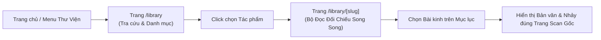

# KẾ HOẠCH TRIỂN KHAI CHI TIẾT (SDLC 10 GIAI ĐOẠN)
## PHASE 3: THƯ VIỆN ĐẠO & BỘ ĐỌC ĐỐI CHIẾU (CORE DIGITAL LIBRARY & READER)

| Thông tin | Chi tiết |
| :--- | :--- |
| **Mã tài liệu** | `PLAN-PHASE-3-LIBRARY-002` |
| **Phiên bản** | `2.0.0` (Chuẩn hóa toàn diện theo Quy trình SDLC 10 Giai đoạn) |
| **Giai đoạn** | **Phase 3 (Phân hệ trọng tâm cốt lõi của Dự án)** |
| **Ngày cập nhật** | 2026-11-19 |
| **Trạng thái** | 🟡 **PROPOSED (Chờ xác nhận để bắt đầu Bước 3 - Database & Migration)** |
| **Định hướng** | **Hướng A:** Hoàn thiện khung kiến trúc, CSDL, API & Bộ đọc đối chiếu song song với dữ liệu mẫu chuẩn mực; sẵn sàng tiếp nhận tư liệu kinh sách thật |

---

## 🏛️ BƯỚC 1. PHÂN TÍCH Ý TƯỞNG VÀ YÊU CẦU (PRD & SCOPE)

### 1.1. Vấn đề giải quyết
Hiện nay, tư liệu kinh sách, Thánh ngôn, Thánh giáo và đạo sử của **Hội Thánh Cao Đài Ban Chỉnh Đạo** lưu truyền qua nhiều thời kỳ, có nguy cơ mai một hoặc tam sao thất bản qua các lần tái bản. Hệ thống cần giải quyết:
- Số hóa, phân loại và bảo quản khoa học toàn bộ kho tàng thư tịch của Hội Thánh.
- Cung cấp công cụ đọc và tra cứu hiện đại, trang nghiêm, dễ đọc trên mọi thiết bị.
- **Quan trọng nhất:** Cung cấp cơ chế **đối chiếu song song với bản scan gốc (bằng chứng đối chiếu tối cao)** để bạn đọc, đồng đạo và nhà nghiên cứu kiểm chứng trực tiếp từng câu chữ, chống chỉnh sửa dị bản.

### 1.2. Đối tượng sử dụng
- **`VISITOR` (Công chúng, Đồng đạo, Nhà nghiên cứu):** Truy cập công khai, tra cứu danh mục, tìm kiếm bài kinh, đọc song song bản văn điện tử và bản scan gốc, tùy chỉnh cỡ chữ, sao chép trích dẫn kèm mã ấn bản và số trang.
- **`MEMBER` (Tín đồ có tài khoản):** Có thêm tính năng lưu dấu trang cá nhân, lưu vị trí trang đang đọc dở dang.
- **`LIBRARY_EDITOR` & `REVIEWER`:** Nhập siêu dữ liệu, tải bản scan gốc, biên tập bản văn số hóa nháp và kiểm duyệt theo quy trình nghiêm ngặt trước khi xuất bản.
- **`SYSTEM_ADMIN`:** Vận hành kỹ thuật, kiểm toán audit logs, sao lưu tệp tin.

### 1.3. Hình thức sản phẩm
- **Web App Responsive** (Desktop, Tablet, Mobile), tối ưu hóa trải nghiệm đọc như sách in xưa (Warm Heritage), sẵn sàng mở rộng PWA offline reader.

### 1.4. Phạm vi tính năng MVP (Bắt buộc có trong Phase 3)
1. **Hệ thống 9 Danh mục Thư viện chuẩn Ban Chỉnh Đạo:** Phân cấp rõ ràng (*Kinh Cúng Tứ Thời, Quan Hôn Tang Tế, Thánh Ngôn, Thánh Giáo, Giáo Lý & Luật Pháp, Đạo Sử & Tiểu Sử, Văn Bản Hội Thánh, Nghi Lễ & Lễ Nhạc, Khảo Cứu & Tham Khảo*).
2. **Quản lý Tác phẩm & Ấn bản (`BR-LIB-01`):** Một tác phẩm có thể có nhiều ấn bản lịch sử khác nhau theo năm và nhà in (*vd: Bản in Bến Tre 1968, Bản in 1995*); **tuyệt đối không tự ý hợp nhất dị bản**.
3. **Bộ Đọc Đối Chiếu Song Song (Split-View Reader):**
   - *Bản văn điện tử:* Định dạng rõ nét, font di sản `Lora`/`Be Vietnam Pro`, thanh công cụ tăng/giảm cỡ chữ.
   - *Bản scan gốc:* Hiển thị trực tiếp hình ảnh/PDF trang scan tương ứng để đối chiếu từng đoạn.
   - *Trên Mobile:* Tự động chuyển thành giao diện 2 tab chuyển đổi mượt mà `[📖 Bản Văn]` và `[📜 Bản Scan Gốc]`.
4. **Mục lục tương tác (Interactive Table of Contents):** Nhấp vào bài kinh/chương để cuộn đến nội dung và tự động mở đúng trang scan gốc.
5. **Tìm kiếm & Bộ lọc:** Tìm kiếm toàn văn theo tên bài kinh, từ khóa giáo lý và lọc theo danh mục.
6. **Dữ liệu Khung Mẫu Chuẩn (Hướng A):** Nạp đầy đủ 9 danh mục chuẩn và 2 tác phẩm khung cấu trúc mẫu ghi nhãn minh bạch `[Dữ liệu thử nghiệm giao diện]`, chờ tiếp nhận tư liệu thật.

### 1.5. Tiêu chí nghiệm thu (Acceptance Criteria)
- **AC-1:** Bạn đọc xem được 9 danh mục kinh sách và danh sách tác phẩm, lọc và tìm kiếm chính xác.
- **AC-2:** Mở tác phẩm xem được đầy đủ thông tin ấn bản, nhà in, năm phát hành và nguồn lưu trữ.
- **AC-3:** Trình đọc Split-View mở mượt mà; click vào mục lục chuyển đúng bài kinh và đúng trang scan đối chiếu.
- **AC-4:** Nút tăng/giảm cỡ chữ hoạt động tức thì; giao diện mobile không bị tràn viền hay vỡ khung.
- **AC-5:** 100% Unit Tests Backend pass và Next.js build thành công.

---

## 🏗️ BƯỚC 2. THIẾT KẾ KIẾN TRÚC HỆ THỐNG

Xác định cụ thể 6 thành phần của Phase 3:
1. **Frontend (`apps/web`):** Next.js 14 App Router, Server Components kết hợp Client Components cho tương tác bộ đọc (`SplitLibraryReader`), Tailwind CSS.
2. **Backend (`apps/api`):** NestJS Modular Monolith (`LibraryModule`, `LibraryController`, `LibraryService`).
3. **Database:** PostgreSQL 16 + PostGIS thông qua Prisma ORM 5.22.
4. **File Storage:** Lưu trữ tệp scan gốc (PDF/ảnh) có mã băm SHA-256 để chống can thiệp file. Hỗ trợ cấu hình song song: thư mục static local `apps/web/public/scans/` cho phát triển/demo và MinIO S3 Object Storage cho production.
5. **Authentication & Authorization:** Scoped RBAC Guards (`VISITOR` chỉ đọc tài liệu `PUBLISHED`; `LIBRARY_EDITOR` biên tập nháp; `REVIEWER` duyệt xuất bản).
6. **External Services:** Giai đoạn MVP hoạt động độc lập, không phụ thuộc dịch vụ ngoài để đảm bảo bảo mật và tốc độ cao.

---

## 🗄️ BƯỚC 3. THIẾT KẾ DATABASE (SCHEMA & MIGRATION)

### 3.1. Các bảng dữ liệu mới (`apps/api/prisma/schema.prisma`)
Bổ sung 6 model và 2 enum chuyên biệt:

- **Enums:**
  - `DocumentEditionStatus`: `DRAFT`, `SUBMITTED`, `IN_REVIEW`, `REVISION_REQUIRED`, `APPROVED`, `PUBLISHED`, `ARCHIVED`, `REJECTED`
  - `DocumentFileType`: `SCAN_ORIGINAL_PDF`, `OPTIMIZED_PDF`, `SCAN_IMAGE`, `AUDIO_MP3`, `COVER_IMAGE`

- **Models:**
  1. `DocumentCategory`: Cây danh mục cha-con (`id`, `parentId`, `slug`, `name`, `description`, `displayOrder`).
  2. `Document`: Đầu mục tác phẩm (`id`, `categoryId`, `slug`, `title`, `authorOrIssuingBody`, `summary`, `isComparativeReference`).
  3. `DocumentEdition`: Ấn bản lịch sử cụ thể (`id`, `documentId`, `editionLabel`, `publicationYear`, `publisher`, `sourceName`, `archiveReference`, `usagePermission`, `status`, `verificationStatus`, `publishedAt`).
  4. `DocumentFile`: Tệp tin đính kèm (`id`, `editionId`, `fileType`, `fileName`, `storagePath`, `checksumSha256`, `fileSizeBytes`, `mimeType`).
  5. `DocumentSection`: Mục lục bài kinh / chương mục (`id`, `editionId`, `parentId`, `slug`, `title`, `orderIndex`, `scanPageStart`, `scanPageEnd`).
  6. `DocumentContent`: Nội dung bản văn số hóa (`id`, `sectionId`, `contentMarkdown`, `originalScanPageRef`, `editorialNote`).

### 3.2. Quan hệ và ràng buộc
- Một Category có nhiều Documents (1-N).
- Một Document có nhiều Editions (1-N). Tuyệt đối không gộp chung các ấn bản khác nhau.
- Một Edition có nhiều Files và Sections (1-N, cascade delete khi xóa bản nháp).
- Một Section có một Content (1-1).

### 3.3. Kế hoạch Migration
- Tạo migration Prisma: `npx prisma migrate dev --name add_library_phase3`.
- Viết kịch bản seed nạp 9 danh mục chuẩn và dữ liệu khung mẫu: `apps/api/prisma/seed-library.ts`.

---

## 🎨 BƯỚC 4. THIẾT KẾ GIAO DIỆN VÀ TRẢI NGHIỆM (UI/UX)

### 4.1. Các trang giao diện
1. **Trang Danh mục & Tra cứu Thư viện (`/library`):**
   - Thanh tìm kiếm phẳng toàn chiều rộng.
   - Cột lọc danh mục 9 nhóm kinh sách chuẩn.
   - Danh sách thẻ tác phẩm di sản (Warm Heritage, 0px border-radius, viền 1px thanh nhã, không card lồng card, font `Lora` & `Be Vietnam Pro`).
2. **Trang Chi tiết Tác phẩm & Bộ Đọc Đối Chiếu (`/library/[slug]`):**
   - Header tác phẩm: Tên kinh sách, bộ chọn chuyển đổi giữa các Ấn bản, trích dẫn nguồn lưu trữ.
   - Trình đọc đối chiếu song song 3 khối:
     - **Mục lục (ToC Drawer/Sidebar):** Danh sách bài kinh, nhấp để chuyển nhanh.
     - **Khung Bản Văn Điện Tử:** Hiển thị văn bản lớn rõ nét, có nút **[A-]** và **[A+]** chỉnh cỡ chữ, nút bật/tắt khung đối chiếu scan.
     - **Khung Bản Scan Gốc:** Hiển thị trang scan đối chiếu tương ứng với bài kinh đang đọc.

### 4.2. Luồng thao tác người dùng (User Flow)


### 4.3. Thiết kế Responsive & Trạng thái giao diện
- **Desktop (>1024px):** Hiển thị song song đồng thời Mục lục + Bản văn điện tử + Bản scan gốc.
- **Tablet (768px - 1024px):** Mục lục dạng ngăn kéo trượt (Drawer) + Bản văn và Bản scan chia đôi màn hình.
- **Mobile (<768px):** Thanh chuyển đổi tab nhanh `[📖 Bản Văn]` và `[📜 Bản Scan Gốc]` để bạn đọc không bị chật màn hình; nút mở mục lục dạng popup tiện lợi.
- **Trạng thái:** Có sẵn giao diện Loading ngà ấm, Empty State trang nghiêm khi không tìm thấy tác phẩm, và thông báo rõ ràng khi file scan đang nạp.

---

## 📁 BƯỚC 5. THIẾT LẬP DỰ ÁN VÀ QUẢN LÝ CODE

- Cấu trúc thư mục phân tách theo đúng kiến trúc Monorepo:
  ```text
  apps/api/
  ├── prisma/
  │   ├── schema.prisma            # Schema 6 bảng thư viện mới
  │   ├── seed-library.ts          # Kịch bản nạp 9 danh mục & mẫu khung
  │   └── seed.ts                  # Gọi seed-library
  └── src/
      └── library/
          ├── library.module.ts    # Module Thư viện
          ├── library.controller.ts# 5 API endpoints công khai
          ├── library.service.ts   # Logic truy vấn & tách biệt ấn bản
          ├── dto/                 # DTOs validate query tìm kiếm & phân trang
          └── library.service.spec.ts # Unit tests

  apps/web/
  ├── src/
  │   ├── app/
  │   │   └── library/
  │   │       ├── page.tsx         # Trang danh mục & tra cứu
  │   │       └── [slug]/page.tsx  # Trang chi tiết & bộ đọc đối chiếu
  │   ├── components/
  │   │   └── library/
  │   │       ├── LibraryExplorer.tsx    # Giao diện danh mục & tìm kiếm
  │   │       ├── SplitLibraryReader.tsx # Bộ đọc đối chiếu song song
  │   │       ├── ScanViewer.tsx         # Trình hiển thị trang scan gốc
  │   │       └── TocDrawer.tsx          # Ngăn kéo mục lục bài kinh
  │   └── lib/
  │       └── library-data.ts      # Dữ liệu fallback offline & types

  packages/shared/
  └── src/
      └── library/                 # Types và Enums dùng chung
  ```

---

## ⚙️ BƯỚC 6. LẬP TRÌNH TỪNG CHỨC NĂNG (4 VERTICAL SLICES)

Thực hiện tuần tự từng lát cắt nhỏ, kiểm thử đạt yêu cầu trước khi chuyển bước:

### 🧩 Slice 3.1: Cơ Sở Dữ Liệu & Kịch Bản Nạp Dữ Liệu Khung Mẫu
1. **Mục tiêu:** Cập nhật schema, tạo migration PostgreSQL và viết kịch bản seed nạp 9 danh mục chuẩn cùng 2 đầu mục khung mẫu.
2. **File thực hiện:** `apps/api/prisma/schema.prisma`, `apps/api/prisma/seed-library.ts`, `apps/api/prisma/seed.ts`.
3. **Kiểm thử:** `npx prisma validate`, `npx prisma migrate dev`, chạy `ts-node prisma/seed.ts` thành công.

### 🧩 Slice 3.2: Backend Library API & Unit Tests
1. **Mục tiêu:** Cung cấp 5 endpoint RESTful:
   - `GET /api/library/categories`: Cây 9 danh mục và số tác phẩm.
   - `GET /api/library/documents`: Tra cứu, phân trang, lọc danh mục.
   - `GET /api/library/documents/:slug`: Chi tiết tác phẩm và các ấn bản `PUBLISHED`.
   - `GET /api/library/editions/:id`: Mục lục và tệp đính kèm của ấn bản.
   - `GET /api/library/sections/:id`: Nội dung bài kinh và số trang scan đối chiếu.
2. **File thực hiện:** `apps/api/src/library/*`, `apps/api/src/app.module.ts`.
3. **Kiểm thử:** Viết Unit Tests `library.service.spec.ts` kiểm tra lọc danh mục, tìm kiếm, phân tách ấn bản; chạy `npm test --workspace=apps/api` đạt 100% pass.

### 🧩 Slice 3.3: Trang Danh Mục & Tra Cứu Thư Viện Đạo (`/library`)
1. **Mục tiêu:** Xây dựng trang danh mục chuẩn di sản, bộ lọc 9 nhóm kinh sách, thanh tìm kiếm toàn văn, kết nối Navbar và Trang chủ. Có dữ liệu fallback offline khi API chưa kết nối.
2. **File thực hiện:** `apps/web/src/app/library/page.tsx`, `apps/web/src/components/library/LibraryExplorer.tsx`, `apps/web/src/lib/library-data.ts`, `Navbar.tsx`, `page.tsx`.
3. **Kiểm thử:** Kiểm tra tìm kiếm tức thì, lọc danh mục, hiển thị responsive trên mobile và desktop.

### 🧩 Slice 3.4: Bộ Đọc Đối Chiếu Song Song (`/library/[slug]`)
1. **Mục tiêu:** Xây dựng trình đọc Split-View Reader:
   - Mục lục tương tác nhảy bài kinh.
   - Khung bản văn điện tử điều chỉnh cỡ chữ (A- / A+).
   - Khung bản scan gốc đối chiếu theo đúng số trang của bài kinh.
   - Thanh chuyển đổi tab thông minh trên mobile.
2. **File thực hiện:** `apps/web/src/app/library/[slug]/page.tsx`, `apps/web/src/components/library/SplitLibraryReader.tsx`, `ScanViewer.tsx`.
3. **Kiểm thử:** `npm run build --workspace=apps/web` thành công 100%, kiểm thử mượt mà trên trình duyệt.

---

## 🔒 BƯỚC 7. BẢO MẬT VÀ PHÂN QUYỀN

- **Quyền đọc công khai (`VISITOR`):** Chỉ truy vấn và hiển thị các ấn bản có trạng thái `status === 'PUBLISHED'`.
- **Bảo vệ bản nháp:** Các ấn bản đang biên tập (`DRAFT`, `SUBMITTED`, `IN_REVIEW`) không bao giờ lộ ra ngoài API công cộng.
- **Kiểm soát dữ liệu đầu vào:** Toàn bộ tham số truy vấn tìm kiếm, slug, phân trang được validate nghiêm ngặt qua DTOs và pipes của NestJS.
- **Toàn vẹn tệp tin:** Mọi tệp scan PDF/ảnh đều được tính toán và kiểm tra mã băm SHA-256 (`checksumSha256`), không cho phép can thiệp nội dung tệp đã phê duyệt.

---

## 🧪 BƯỚC 8. KIỂM THỬ TOÀN HỆ THỐNG

Trước khi nghiệm thu Phase 3, bắt buộc vượt qua toàn bộ các bài test:
1. **Unit Test:** Kiểm tra logic tìm kiếm không dấu/có dấu, lọc phân cấp danh mục, tách biệt ấn bản.
2. **Integration Test:** Kiểm tra endpoint API kết nối thành công với database PostgreSQL và trả về đúng JSON schema.
3. **Responsive Test:** Kiểm tra giao diện bộ đọc trên 3 kích thước: Desktop (1920x1080), Tablet (768x1024), Mobile (375x812).
4. **Error Handling Test:** Kiểm tra trạng thái khi người dùng tìm kiếm từ khóa không có kết quả, hoặc khi mở một bài kinh chưa có bản scan đính kèm (hiển thị placeholder lịch thiệp, không crash trang).

---

## 🚀 BƯỚC 9. TRIỂN KHAI PHẦN MỀM

- Chạy kiểm tra biên dịch toàn monorepo: `npm run build`.
- Chạy kiểm thử tự động toàn hệ thống: `npm test`.
- Xác nhận Docker container database (`caodai_bcd_db`) nhận migration mới ổn định.
- Chuẩn bị sẵn phương án rollback nếu migration có sự cố.

---

## 🛠️ BƯỚC 10. BẢO TRÌ VÀ PHÁT TRIỂN

- Cập nhật [`HANDOFF.md`](../../HANDOFF.md) ghi nhận hoàn tất Phase 3.
- Chuẩn bị sẵn quy trình và biểu mẫu để khi bạn có tệp scan PDF và bản văn kinh sách thật (như *Kinh Cúng Tứ Thời*, *Thánh Ngôn Hiệp Tuyển*, *Quan Hôn Tang Tế*), hệ thống có thể nạp vào ngay lập tức mà không cần sửa code giao diện.
- Sẵn sàng tiến tới **Phase 4: Document Composer (Soạn Sớ Văn & Biểu Mẫu Nghi Lễ)**.
